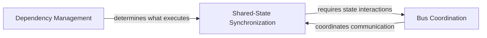
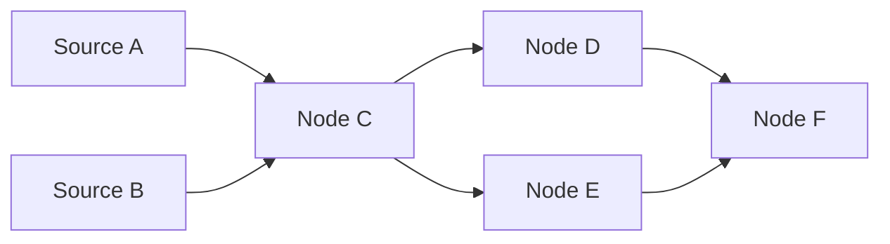
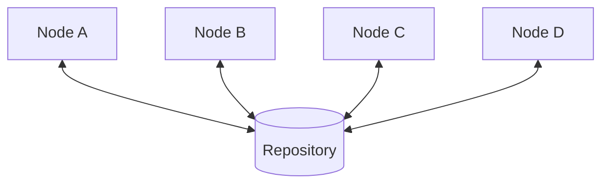
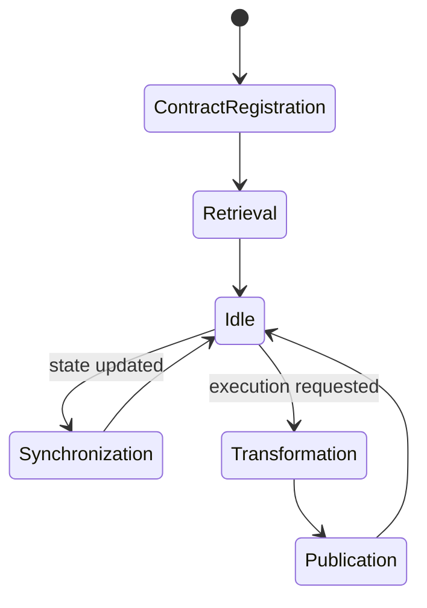
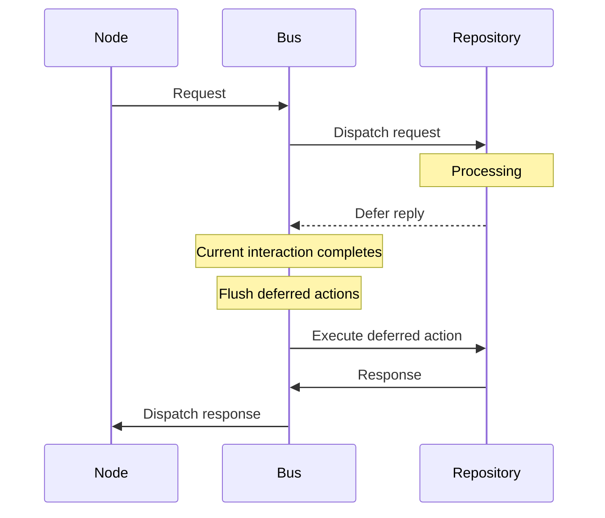

# Reed Architecture

Reed is a computational framework for coordinating interdependent transformations through explicit dependencies, shared state, and structured communication.

Its architecture is organized around three core mechanisms:

1. **Dependency Management**
2. **Shared-State Synchronization**
3. **Bus Coordination**


Dependency Management captures the relationships among these artifacts, allowing reasoning about the impact of changes. Shared-State Synchronization maintains a Single Source of Truth (SSOT) by ensuring that artifacts and their supporting information remain synchronized via Bus Coordination. 




**Dependency Management** determines which transformations are required.

**Shared-State Synchronization** provides nodes with the state required to perform those transformations while maintaining the Repository as the Single Source of Truth.

**Bus Coordination** defines how those interactions occur and preserves their ordering, identity, and causal relationships.


Together, these mechanisms define how computational units depend on one another, how state is maintained consistently across the system, and how interactions between components are coordinated.

---

## Dependency Management

Artifacts produced by a computational workflow often depend on other artifacts or supporting information.

Reed represents these relationships explicitly as a **data-flow graph**.

Each node represents a computational unit that consumes state and produces or transforms artifacts. Dependencies between nodes determine the order in which transformations may occur.

Conceptually:

```text
Artifact A ──▶ Node 1 ──▶ Artifact B ──▶ Node 2 ──▶ Artifact C
```

When an execution request is received, Reed determines the execution path required to satisfy that request and activates the corresponding nodes according to their dependencies.

This separates two concerns:

- **what depends on what**, represented by the graph;
- **when something should execute**, determined by the execution mechanism.

### Dependency Graph

A dependency graph may contain multiple branches:



Changes can therefore be propagated only through the affected portion of the graph rather than requiring the entire computation to be executed again.

---

## Shared-State Synchronization

Nodes require access to the artifacts and supporting information they consume.

Reed maintains this information through a centralized **Repository**, which acts as the system's **Single Source of Truth (SSOT)**.



Nodes do not constitute independent authoritative sources of state.

Instead, each node maintains a **local view** containing the subset of state required for its operation, while the Repository remains authoritative.

This produces two distinct notions of state:

### Shared State

The authoritative state maintained by the Repository and potentially accessible by multiple nodes.

### Local State

The synchronized subset of state maintained by an individual node for its own execution.

---

## Node Lifecycle

Interaction between a node and the Repository follows an explicit lifecycle.

The lifecycle consists of six phases:

1. **Contract Registration**
2. **Retrieval**
3. **Synchronization**
4. **Transformation**
5. **Publication**
6. **Idle**



### Contract Registration

When a node is created, it declares the state elements involved in its operation.

Its contract specifies which elements the node:

- consumes;
- mutates;
- produces.

### Retrieval

After its contract is accepted, the node retrieves the state elements required to establish its initial local view.

### Idle

Once initialized, the node waits for either:

- an update to relevant shared state; or
- an execution request.

### Synchronization

When relevant state changes in the Repository, the node refreshes its local view.

After synchronization, it returns to the Idle state.

### Transformation

When execution is requested, the node performs its computation using the state declared by its contract.

### Publication

Artifacts or state changes produced during transformation are published back to the Repository.

The Repository then becomes the authoritative source for the new state.

---

## Bus Coordination

Communication between Nodes and the Repository is coordinated through a **Bus**.

The Bus organizes interactions into semantic communication channels.

Each channel is identified by a **topic** associated with a particular interaction or lifecycle operation.

Examples include:

```text
contract
retrieve
synchronize
publish
```

A node may therefore expose multiple communication endpoints while maintaining a single identity within the system.

Conceptually:

```text
                 ┌───────────────┐
                 │      Bus      │
                 └───────────────┘
                   ▲     ▲     ▲
                   │     │     │
             contract retrieve publish
                   │     │     │
                   ▼     ▼     ▼
                 ┌───────────────┐
                 │     Node      │
                 └───────────────┘
```

Routing is determined by the combination of:

- sender identity;
- recipient identity;
- communication topic.

---

## Messages and Communication Context

Every message contains two conceptually distinct components:

```text
Message
├── Payload
└── Context
```

The **payload** describes the requested operation or transmitted data.

The **communication context** contains metadata necessary to coordinate the interaction, including:

```text
sender
recipient
topic
trace_id
reply_to
```

Each interaction receives a unique `trace_id`.

Replies constitute new interactions with their own `trace_id`, while referencing the original interaction through `reply_to`.

For example:

```text
T1: Node ───── request ─────▶ Repository
                              │
                              │ reply_to = T1
                              ▼
T2: Node ◀──── response ───── Repository
```

This creates an explicit causal chain between interactions.

---

## Split-Phase Execution

Bus communication follows a **split-phase execution model**.

An interaction is divided into:

1. **Processing**
2. **Flush / Post-processing**

During processing, a receiving component handles the current message and computes its local result.

Communication side effects generated during processing are **not emitted immediately**.

Instead, they are deferred.



Only after the current interaction has completed does the Bus flush the deferred actions.

This prevents communication generated during message processing from recursively creating new interactions before the current interaction has finished.

As a result, the execution model preserves:

- deterministic execution;
- causal ordering;
- explicit interaction boundaries;
- traceable request-response chains.

---


