# Reed Architecture

Reed is a computational framework for coordinating interdependent transformations through typed artifacts, explicit dependency structure, and reactive propagation. A user models a domain as a set of typed values and the transformations between them; Reed turns that model into an executable dataflow, decides what must recompute when something changes, and keeps a single authoritative record of every artifact it produces along the way.

This document describes Reed's architecture at the level of concepts and mechanisms, independent of any particular class or data structure. Concrete names appear only for orientation.

---

## Architectural Overview

Reed's design rests on three ideas held apart on purpose:

1. **Composition is not execution.** Defining a computation, wiring it into a dataflow, and actually running it are three different scopes with three different lifetimes.
2. **A value is not the same thing as an artifact.** The domain value a transformation returns is distinct from the identity, version, and provenance Reed attaches to it once it is committed.
3. **Noticing a change is not deciding to act on it.** Change propagates through the dependency graph continuously; whether that propagation causes a node to execute is a separate, explicit policy decision.

These three separations recur throughout the architecture and are the basis for the four layers below.

A fourth idea sits alongside the first three, orthogonally rather than sequentially:

4. **Executing a computation is not the same activity as understanding it.** Running a reactive dataflow to completion tells an observer nothing, by itself, about which computational activities actually occurred, which versions of which data participated in them, or which domain-specific quantities were observed along the way. A runtime that only computes has already discarded the information a scientist, an operator, or a future version of the same system would need to reconstruct what happened.

This fourth idea is not a fifth stage a value passes through on its way somewhere. It is a second plane of concern, standing beside the first three rather than after them — a **computational plane**, which decides what is computed and when, and an **observation plane**, which decides what can be reconstructed about that computation after (or during) the fact. Every mechanism in the computational plane can, in principle, run with the observation plane silent; every mechanism in the observation plane exists only to describe activity the computational plane already decided to perform. Neither plane is allowed to alter the other's outcome: an observation is never permitted to change what was computed, and computation is never permitted to depend on whether anything is watching.

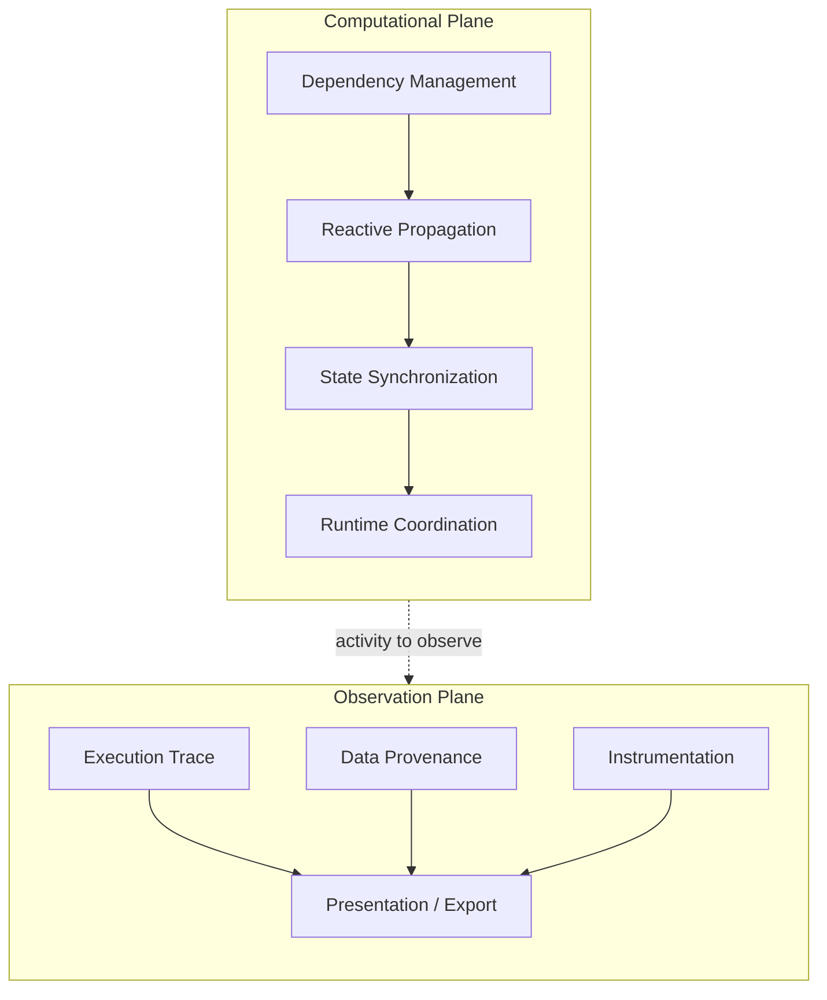

The computational plane is described first, in Sections 1 through 4, exactly as it was before this document incorporated the observation plane. The observation plane is described in Section 5. The two-plane framing itself is the more important structural fact: a reader who has understood Sections 1-4 has understood everything necessary for Reed to compute correctly; Section 5 answers a different question, about what can be known of that computation afterward, and depends on Sections 1-4 for its vocabulary (artifacts, versions, firings, commits) without changing any of their guarantees.

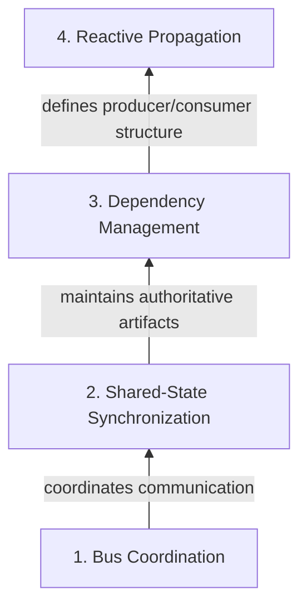

**Computational Plane**

| Layer | Question it answers |
|---|---|
| Bus Coordination | How do components communicate? |
| Shared-State Synchronization | Where does authoritative truth live, and what is merely local? |
| Dependency Management | What depends on what? |
| Reactive Propagation | What must react when something changes, and when? |

**Observation Plane** (orthogonal to the above, not a fifth row appended to it — see Section 5)

| Concern | Question it answers |
|---|---|
| Execution Tracing | What happened? |
| Data Provenance | Why did this value exist? |
| Instrumentation | What domain-specific property did the application choose to observe? |

---

## Architectural Principles

### Composition and Execution Are Separate Lifecycle Scopes

Reed distinguishes four nested scopes, each strictly contained in the next:

```text
Computational Definition -> Flow Participation -> Execution Instance -> Individual Firing
```

- A **computational definition** is a reusable unit of computation — a typed transformation from declared inputs to a declared output. It carries no notion of any particular flow or run.
- **Participation in a Flow** is what happens when a definition is added to a composition boundary (a **Flow**). The same definition may participate in more than one Flow, or in principle more than once in the same Flow; participation gives it a place in a topology, not a copy of its logic.
- An **execution instance** (a **Run**) is one concrete execution of a Flow. Two Runs of the same Flow share no state: each gets its own authoritative artifact store and its own materialized runtime for every participating node.
- An **individual firing** is one execution attempt of one node's participation, inside one Run. A node's participation may fire many times over the life of a Run — once per qualifying arrival of new data.

This separation exists so that a reusable computation never accidentally carries state across unrelated Flows or unrelated Runs, and so that concurrent or repeated Runs of the same Flow are independent by construction rather than by convention.

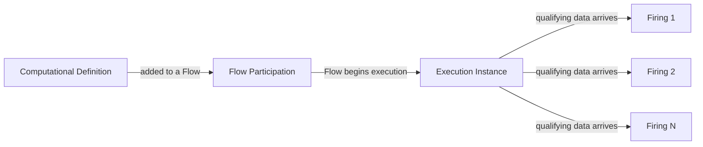

Two further identities complete the picture, and belong to the artifact side of the same hierarchy rather than the node side: an **artifact identity** is stable for as long as its producer's participation exists, and an **artifact version** is one committed value of that identity, changing every time its producer commits again. Every one of these six scopes has a distinct lifetime, and no scope's identity is ever reused to stand in for another's:

| Identity scope | Stable across | Changes when |
|---|---|---|
| Computational definition | every Flow it participates in, every Execution of every such Flow | the definition itself is redefined |
| Flow participation | every Execution of the same composition | the composition's topology changes |
| Execution instance | every firing that occurs during one run | a new, independent run begins |
| Firing | nothing beyond itself — it is the smallest unit | the same participation is asked to compute again |
| Artifact identity | every version committed during one Execution | the producer's computational role changes |
| Artifact version | nothing beyond itself — it is one committed value | its producer commits a new value |

This table is what later grounds the observation plane's own vocabulary (Section 5) without needing to introduce anything new: an execution trace is a record of firings against one execution instance; provenance is a record of which artifact versions a firing consumed and which it produced; and an instrument binding, introduced in Section 5, is simply this same identity discipline applied to observation instead of computation. A system that needed distributed identifiers to correlate work across process or machine boundaries would derive them from exactly this hierarchy — an execution instance's identity extended with a firing's identity is already sufficient to correlate any observation with the specific computational activity that produced it, with nothing further to invent.

### Producer-Consumer Organization

Reed models computation as a graph of typed artifacts flowing between producers and consumers. A node consumes some artifacts and produces one artifact; execution order is never stated by the user — it is inferred from which artifacts exist and which nodes need them.

```text
Artifact A -> Node 1 -> Artifact B -> Node 2 -> Artifact C
```

### Unique Producer Responsibility

Within one Flow, each artifact has exactly one node responsible for producing — and, over the life of a Run, maintaining — it. This is what allows Reed to infer a dependency graph purely from a Flow's composition: if an artifact exists, there is exactly one place its next version can come from. A node may not both consume and produce the same artifact identity; a stage that appears to transform a value into "more of the same" must be expressed as a new, distinct downstream identity instead.

### Shared and Local State Separation

Reed distinguishes two notions of state that must never be confused:

| State | Meaning |
|---|---|
| Authoritative (shared) state | The current, committed value of every artifact in a Run — the only state other nodes, and the outside world, can observe. |
| Node-local state | Private computational continuity a node keeps for itself, and a synchronized view of its own most recent committed result. Never authoritative for anyone but that node. |

A node may consult and update its own local state freely; it can never make that state visible to, or authoritative for, any other node.

### Change Detection Is Not Execution Eligibility

An artifact changing does not by itself mean anything should run. Change establishes that dependents *may* be out of date; a separate, explicit **trigger policy** decides whether that possibility becomes an actual execution. This is the architectural boundary between "something happened" and "this should now run."

### Selective, Reactive Recomputation

Reed does not recompute a whole Flow when one artifact changes. A change propagates only through the part of the dependency graph that is actually reachable from it, and only nodes whose trigger policy judges them eligible actually fire. Propagation continues, hop after hop, until no further node becomes eligible — a **quiescent** state.

---

## 1. Bus Coordination

### Purpose

Bus Coordination is the substrate of communication: how requests, responses, and updates move between components without components needing direct references to each other.

A naive alternative — components holding direct references to one another and calling each other synchronously — makes the set of collaborators for any one component implicit in its code rather than visible in its wiring, and lets a reaction to one message recursively trigger another message before the first interaction has finished, so cause and effect become impossible to separate once a handler's own side effects start calling back into the system that invoked it. Routing every interaction through a bus with an explicit, deferred flush phase avoids both problems at once: components are addressable by topic rather than by reference, and no interaction can recursively reenter another before it completes.

### Core Concepts

| Concept | Meaning |
|---|---|
| Bus | The communication mechanism that routes messages between components. |
| Topic | A semantic channel associated with a kind of interaction (e.g. contract, retrieve, synchronize, publish). |
| Message | A payload describing an operation or carrying data, paired with communication context. |
| Communication Context | Metadata needed to route and causally order a message: sender, recipient, topic, trace identifier, reply-to. |

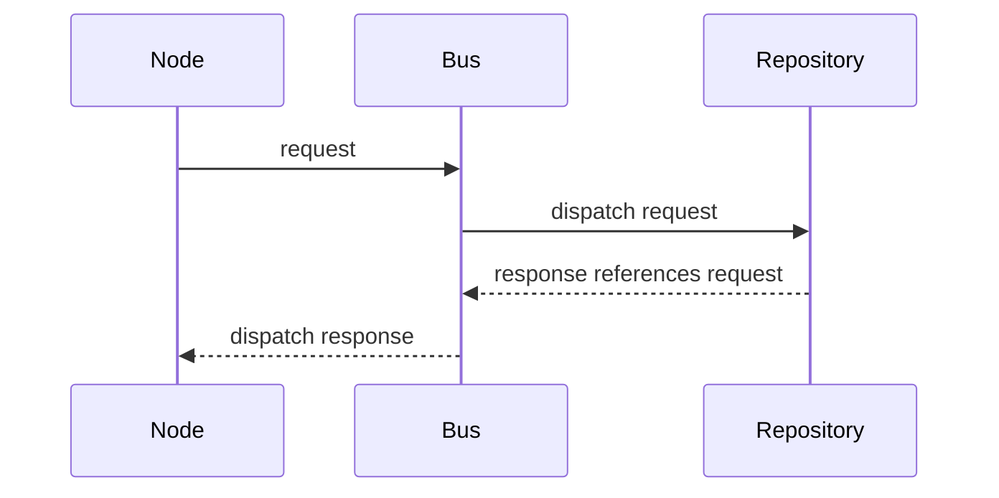

### Split-Phase Execution and Causal Ordering

Every interaction has two phases: **processing**, in which a receiver computes a local result, and **flush**, in which any communication side effects that processing generated are actually emitted. Side effects produced while handling one message are deferred until that interaction completes, rather than emitted immediately and recursively.

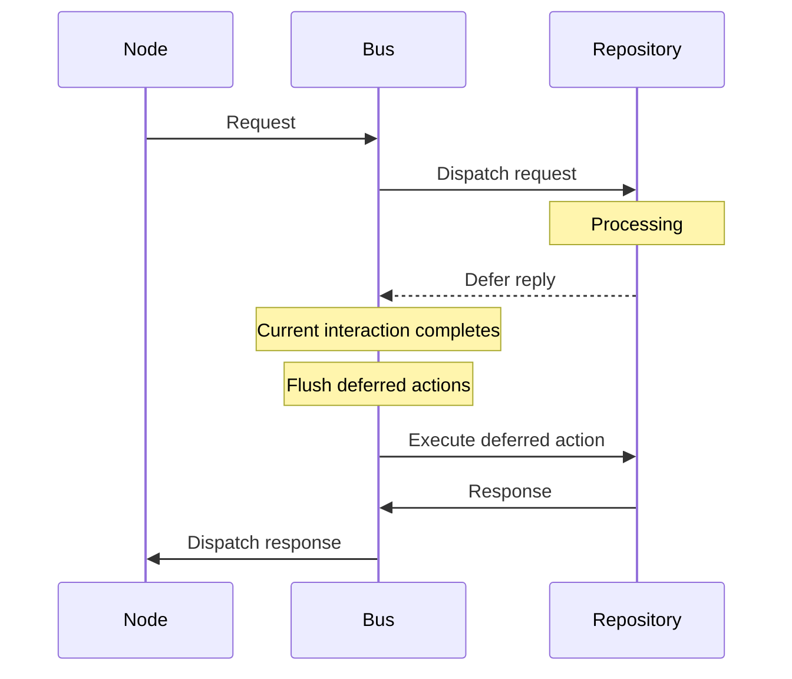

This keeps cause and effect distinguishable even when a reaction to one message would otherwise trigger another message inline, and it gives every interaction a traceable identity.

### Guarantees

- causal ordering between interactions;
- explicit, non-recursive interaction boundaries;
- deterministic message processing;
- traceable request/response chains.

---

## 2. Shared-State Synchronization

### Purpose

This layer establishes where authoritative truth lives, and how a node's private view of the world stays consistent with it.

A naive design would let any node read and write shared values directly, in whatever representation is convenient at the call site. That collapses the domain value a transformation computes into the same thing as its committed, versioned, provenance-carrying record — so two nodes can disagree about which value is current, or overwrite each other's commits, with no way to reconstruct afterward who produced what from which inputs. Reed avoids this by making commitment to authoritative state the only way a value becomes visible to anyone but its producer, and by deriving identity, versioning, and provenance from the artifact model rather than leaving them to be reinvented ad hoc at each call site.

### The Artifact Model

Reed distinguishes several things that a less careful design would collapse into one:

| Concept | Meaning |
|---|---|
| Domain value | The plain value a transformation actually computes — what the user's code sees and returns. |
| Artifact identity | What role that value plays in the computation: which position in the dependency graph it occupies, and who is responsible for producing and maintaining it. In Reed, the domain **type** *is* the artifact's semantic identity — two values of the same type occupying different computational roles must be given different types. |
| Artifact version | One committed instance of an artifact's value over time. Identity is stable across a Run; version changes every time the responsible node commits a new value. |
| Provenance | Metadata recorded alongside a committed version: which node produced it and which versions of its own inputs it was produced from. |
| Authoritative artifact state | The current committed version of an artifact, held by the one place in a Run that is allowed to be authoritative for it. |

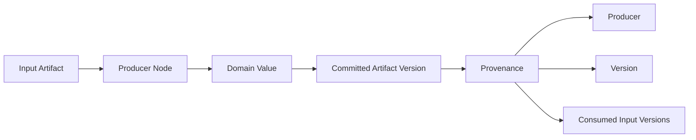

A user node never manipulates artifact identity, versions, or provenance directly — it consumes and returns plain domain values. Reed derives artifact identity from the value's type, wraps and unwraps it at the node boundary, and manages versioning and provenance entirely on its own. This lets application code stay purely about domain meaning while Reed's execution machinery remains free to evolve underneath it.

### Node Lifecycle

A node's participation in a Run moves through a small number of phases:

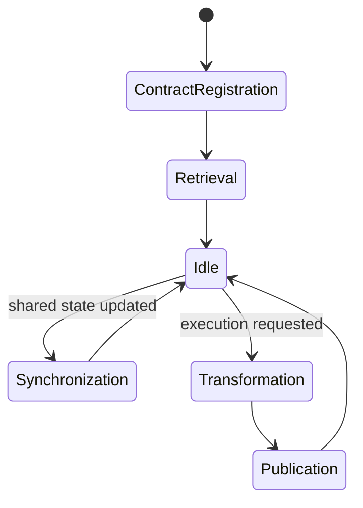

| Phase | Meaning |
|---|---|
| Contract Registration | The node declares which artifact types it consumes and which it produces. |
| Retrieval | The node's participation is materialized and given whatever local state it needs to begin. |
| Idle | The node's participation waits for relevant artifact changes or an explicit execution request. |
| Synchronization | Newly arrived values relevant to this node are recorded. |
| Transformation | The node computes a new domain value from its currently available inputs. |
| Publication | The produced value is wrapped into a versioned artifact and committed to authoritative state, with provenance. |

### Guarantees

- exactly one authoritative store of committed artifact state per execution instance;
- a firm separation between authoritative and local state;
- every committed artifact carries provenance;
- publication is an explicit, observable boundary — nothing becomes authoritative silently.

---

## 3. Dependency Management

### Purpose

Dependency Management answers what depends on what, purely from a Flow's composition — never from a manually declared execution order.

A design that instead asked the user to declare execution order directly would work until the topology changed: every reordering, insertion, or removal of a node would require re-auditing every ordering statement by hand, and an order that quietly fell out of sync with the actual data dependencies would fail silently rather than being rejected. Inferring the graph from producer-consumer relationships instead means an order is never stated as a separate fact that can drift from the dependencies it is supposed to reflect — it is recomputed, correctly, every time the graph itself changes.

### Producer-Consumer Graph

Nodes are edges between artifact-typed nodes in a graph: each node consumes some artifact types and produces one. The graph may branch (one artifact feeding several independent consumers) and join (one node consuming several artifacts at once):

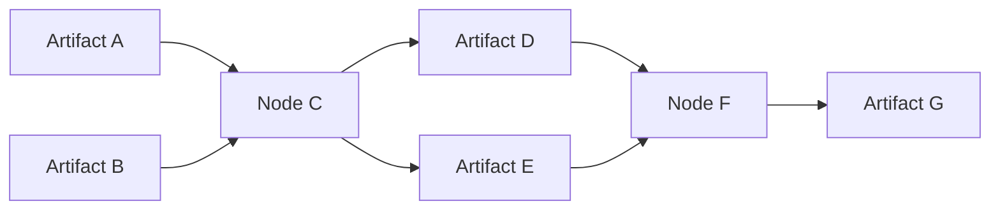

### Unique Producer Responsibility, Revisited

Because each artifact type has exactly one producer within a Flow, the dependency graph is unambiguous by construction: consuming an artifact of a given type always means consuming a value whose origin and maintenance responsibility are already known. A Flow that would introduce two producers for the same artifact type, or a node that would consume and produce the same type, is rejected when the Flow is composed — before any execution takes place.

```text
Artifact identity = value role + responsible producer + position in the computation
```

An artifact's data type alone is not its full identity; two values with the same shape but different roles in the computation must be modeled as different types, so that the graph Reed infers reflects the computation's actual structure.

### Flow Boundary

A Flow is the composition boundary within which Reed can answer: which artifacts exist, which node produces each, which nodes consume each, and — from that — what would be affected if any one artifact changed. None of this requires the user to state an execution order; order is a consequence of the graph, not an input to it.

### Guarantees

- explicit, inferred artifact dependencies;
- unambiguous producer responsibility for every artifact;
- rejection of ambiguous or self-referential producer relationships at composition time, before execution;
- a firm separation between an artifact's data type and its architectural identity.

---

## 4. Reactive Propagation

### Purpose

This layer determines what must react when an artifact changes, and governs the mechanism by which a single committed value can cause a cascade of further computation across the whole reachable dependency graph, until nothing more is eligible to run.

A naive reactive design collapses "an input changed" and "this node should now run" into the same event, firing eagerly on every arrival. That either recomputes a multi-input join once per input instead of once per meaningful update — wasting work and, worse, sometimes producing results from a partial, not-yet-complete set of inputs — or, if it waits for every input naively, it can deadlock a node whose inputs never all change together. Separating change detection from a node's own trigger policy avoids both failure modes: a node only fires once its declared inputs are covered, and only when its own policy judges the resulting pattern of changes eligible.

### Core Concepts

| Concept | Meaning |
|---|---|
| Change | A new committed version of an artifact becoming available. |
| Execution eligibility | Whether a node whose inputs have changed is actually allowed to fire now. |
| Trigger policy | The rule, attached to one node's participation in a Flow, that decides eligibility from the pattern of which of its inputs have changed. |
| Commit | The act of making a produced value the new authoritative version of its artifact. |
| Observation | External notice of a commit, strictly after it has happened. |
| Quiescence | The state reached when no further node is eligible to fire — propagation has run to completion. |

### The Reactive Cycle

A single published value is the seed of a cascade, not a one-shot call. Each committed artifact is checked against every node that consumes its type; for each such node, Reed records the arriving value, checks whether every one of that node's declared inputs now has some known value (a node can never be called with a missing input), and only then consults that node's trigger policy to decide eligibility. An eligible node fires using the most recent known value for each of its inputs, its result is committed, and that commit in turn seeds the same check for its own consumers. The cascade continues, hop after hop, until no pending value produces a newly eligible node — the graph reaches quiescence.

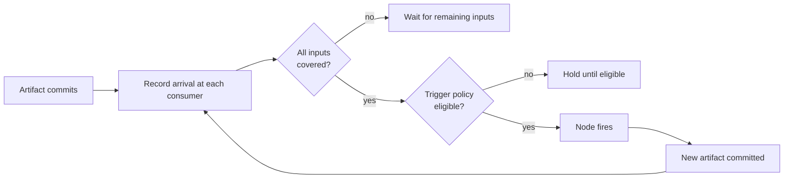

This single mechanism accounts for everything the reactive model needs to support:

- **Automatic multi-hop propagation** — a commit at one node can cause a chain of further commits several hops downstream, without any of it being restated by the caller.
- **Branching / fan-out** — one committed artifact can make more than one downstream node eligible at once; each is considered independently.
- **Multi-input joins** — a node with several declared inputs is only ever fired once every one of them has a known value, and (depending on its policy) only once the relevant inputs have changed since its last firing.
- **Repeated updates** — a node's participation can fire many times across a Run's life, once per qualifying new arrival; nothing about the mechanism assumes a single firing per node.
- **Quiescence** — because propagation is driven by a queue of pending commits that is processed until empty, a cascade always terminates once nothing further becomes eligible, giving the Run a well-defined settled state after each externally introduced change.

### Trigger Policy: Change Is Not Execution

Full coverage of a node's inputs is necessary but not sufficient for it to fire. A trigger policy is the second, independent gate:

- fire on *any* input changing, once every input has at least some value;
- fire only once *every* input has changed since the node's last firing (a true join semantics, reset after each firing);
- never fire automatically — only in response to an explicit request.

The trigger policy belongs to the node's participation in the Flow, not to the artifact type or to the reactive mechanism itself; it is the one place application-specific eligibility logic lives, keeping "did something change" and "should this run now" strictly separate concerns.

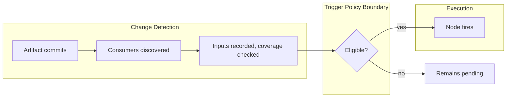

### Commit, Then Observation

A firing computes a plain domain result; Reed commits the corresponding artifact version to authoritative state; only after that commit succeeds does any external observer — a callback, a downstream log, a UI — get to see the value. Observation never precedes or substitutes for commitment, and a failure in an observer cannot retroactively undo a commit that already happened: computation, commitment, and observation are three distinct, ordered stages, and a fault in the last never contaminates the first two.

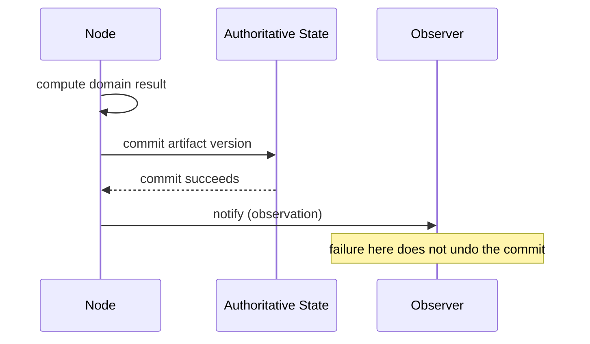

### Guarantees

- localized reaction to change — only the reachable, eligible part of the graph is ever recomputed;
- automatic downstream propagation across arbitrarily many hops, including branches and joins;
- a strict separation between change detection, execution eligibility, and observation;
- a well-defined, reachable quiescent state after any externally introduced change;
- observation strictly follows successful commitment, and never the reverse.

---

## 5. Execution Observability

### Purpose

Executing a reactive computation is insufficient for understanding it. A runtime must also preserve enough information to reconstruct which computational activities occurred, which data versions participated in them, and which domain-specific quantities were observed during execution. This is a distinct architectural problem from the one Sections 1-4 solve: those sections describe how Reed decides what to compute and when; this section describes what can be known about that computation after (or during) the fact, without ever feeding back into what was computed.

Three different questions arise from this problem, and a design that collapses them loses the ability to answer any of them precisely:

| View | Question it answers |
|---|---|
| Execution tracing | What happened? |
| Data provenance | Why did this value exist? |
| Instrumentation | What property of the computation did the application observe? |

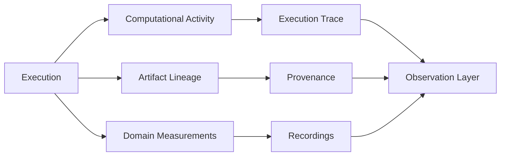

These three views cannot be collapsed into one another. A firing raising an error is part of execution — it is not an instrument observation. A measured temperature is an observation the application chose to make — it is not provenance. The statement "artifact version B₂ was produced using artifact version A₃" is provenance — it is not simply a claim about temporal order. Each view answers a question the other two structurally cannot.

### Temporal Order Is Not Causality

Temporal order alone is insufficient to reconstruct computational causality. Two activities may occur one after another without either contributing data to the other, while an artifact produced much earlier may remain causally relevant much later — its most recent committed version may still be exactly what a firing much further downstream consumes. Knowing only that "activity 41" preceded "activity 42" preceded "activity 43" establishes nothing about which of them, if any, depended on which.

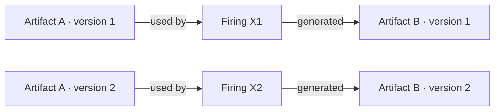

Reed therefore represents causality explicitly, through generation and usage relationships between firings and versioned artifacts, never through the order in which activities were merely observed to occur. Every firing records which artifact versions it consumed and which artifact version it generated; that relationship — not sequence position — is what a reader traverses to answer "why did this value exist." Sequence position remains useful for reconstructing the order in which activities were observed to happen — a legitimate and separate question — but it is never treated as a substitute for lineage, and a system built on this architecture must resist the temptation to infer causality from convenient temporal proximity.

### Execution Tracing

An execution trace answers "what happened": a chronologically ordered record of computational activities — which participation fired, when it started, when it finished, and whether it succeeded or failed — scoped to one execution instance. Ordering here is deterministic *observation* order: it reconstructs the sequence in which the runtime became aware of each activity's start and completion, which is exactly the information needed to answer questions like "how many firings occurred," "how long did each take," and "in what order did the runtime observe them" — and exactly the information *not* sufficient to answer "did this firing's result depend on that one."

### Data Provenance

Data provenance answers "why did this value exist": for every artifact version a firing generates, which firing generated it, and which versions of which other artifacts that firing consumed to do so. Because each artifact identity has exactly one responsible producer within a Flow (Section 3), and because commitment always advances an artifact's version cleanly (Section 2), a chain of generation and usage relationships can be followed indefinitely — forward from a version to everything it caused, or backward from a version to everything that caused it — independent of when any of those activities happened to occur relative to one another. This is what lets a reader reconstruct the full ancestry of any committed value, a capability temporal ordering alone could never provide.

### Instrumentation as a Semantic Model

Instrumentation answers a third, orthogonal question: what domain-specific property of the computation did the application itself choose to observe? Unlike execution tracing and provenance — both of which the runtime maintains automatically, as an unavoidable consequence of firing and committing — an instrumented observation exists only because application code explicitly decided to record it. A runtime error belongs to execution tracing; a temperature reading belongs to instrumentation; neither is the other.

Reed's instrumentation model distinguishes three concepts, each with a different lifetime and a different scope, mirroring the identity discipline established in Section 1:

An **instrument definition** gives semantic identity to a family of observations: what is being measured, the admissible value domain, its measurement semantics, and, when applicable, its unit. It exists independently of any particular computation — the same instrument definition (a temperature, a count of anomalies, a queue depth) is meaningful wherever that quantity might be measured, in this Flow or any other.

An **instrument binding** associates that semantic definition with a particular computational role in a Flow — a specific participation, in a specific composition. The binding is what gives a series of observations a consistent origin: it is the difference between "temperature, in general" and "the temperature this specific stage of this specific Flow measures."

A **recording** is one concrete observation produced by such a binding during an individual firing — one value, one timestamp, one place in the identity hierarchy it was produced from.

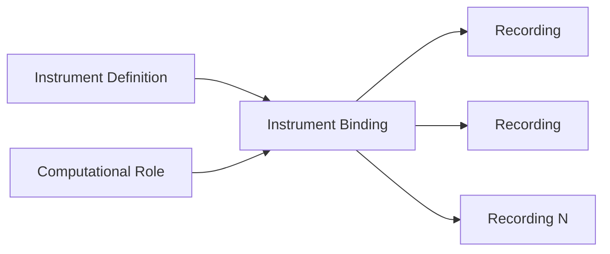

This three-level structure is what allows the same semantic instrument to be reused across different computational roles without conflating their observational series: a recording's identity is never the bare instrument definition alone, but the binding — instrument definition together with the specific computational role that produced it — exactly mirroring how an artifact's identity is never its bare data type alone, but that type together with the one producer responsible for it within a Flow (Section 3). Reusing an instrument definition across two different participations is therefore unproblematic by construction: each participation establishes its own binding, and each binding accumulates its own, uncontaminated series of recordings.

What matters architecturally is the three-level identity discipline itself, not any particular construct used to express it: a definition, a binding, and a recording, each with a distinct lifetime, related the same way regardless of how any given implementation chooses to represent them.

### Instrumentation Is Discovered, Not Declared

A further architectural decision governs how an instrument binding comes to exist: instrumentation is observational rather than compositional. The computational topology does not require prospective knowledge of every quantity that may be observed during execution — a binding is established the first time a computational activity actually emits a typed observation during a real execution, not declared ahead of time as part of composing the Flow.

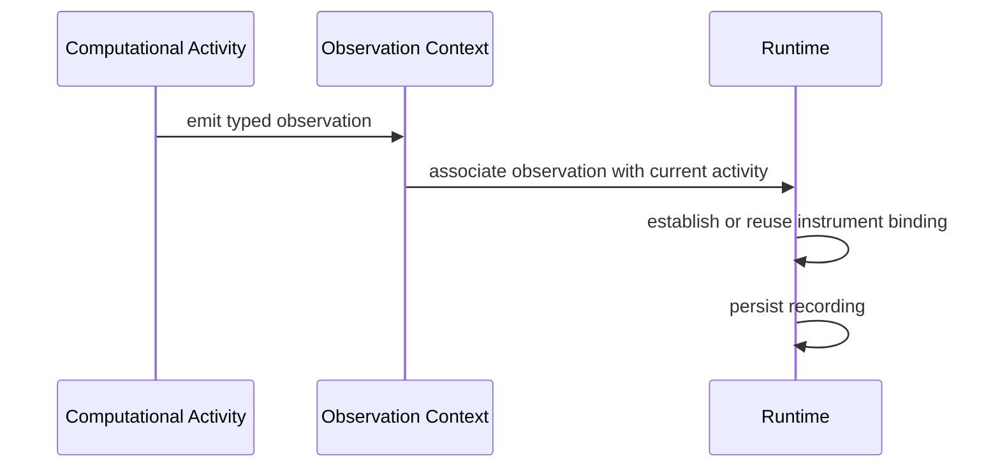

This is a genuine trade-off, not a cost-free simplification, and it is worth stating explicitly what each alternative buys:

```text
Prospective declaration
        ↓
what may be observed

Runtime discovery
        ↓
what was actually observed
```

Prospective declaration would let an observer inspect a composition and know, before any execution runs, the complete set of quantities it could ever measure — valuable for static documentation and validation, at the cost of a second declaration that must be kept in agreement with what the computational activity's own body actually does, a redundancy this architecture treats as a cost rather than a safety net (an artifact's produced type is never declared a second time separately from the transformation that produces it, and the same discipline now applies to instruments). Runtime discovery instead reports only what a computation has actually been observed to measure, which is always accurate by construction — it can never drift out of agreement with the computation's real behavior, because it is derived from that behavior directly — at the cost of being unable to answer, before any execution has occurred, what a computation *might* measure. Reed chose runtime discovery: recovering a prospective inventory of possible observations through static analysis of a computational activity's own definition (for instance, by inspecting its source) was considered and rejected, both because it is fragile against any indirection between the activity and where the observation is actually emitted, and because it would reintroduce, through a side door, exactly the kind of inference-from-structure that this architecture otherwise reserves only for the dependency graph itself (Section 3), since the choice depends only on where the responsibility for discovering an observation is placed: at composition time, or at execution time.

### Observation Granularity: Logical Unit, Physical Boundary

An instrument is the logical unit of observation — the unit at which recordings are semantically comparable and analytically meaningful. This is deliberately a different concept from the boundary at which observations are physically isolated and made durable. An execution instance is a natural isolation boundary for persistence: everything an execution instance observes is self-contained, attributable to that one run, and safe to persist or discard independently of every other execution instance of the same Flow. Aggregating across many execution instances of the same Flow — to compare how one instrument's values evolved run over run — is a different, later operation, layered on top of per-execution isolation rather than replacing it.

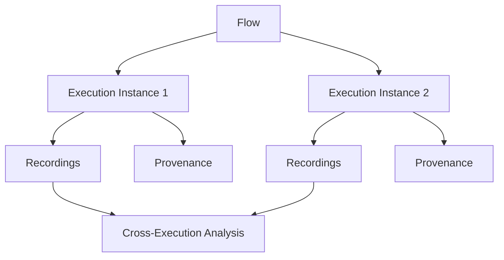

Collapsing these two concepts — treating the instrument itself as the unit of physical isolation, for instance by giving each instrument its own persistent, execution-spanning store — would entangle a purely semantic distinction (what is being measured) with a purely operational one (what is safe to isolate and discard together), and would make it substantially harder to reason about what one execution instance is responsible for. Keeping them separate is what lets a single instrument's observations be persisted, queried, and reasoned about consistently whether they came from one execution or many, without that consistency requiring any single execution instance to know about any other.

### Observation Is Not Presentation

The runtime's responsibility ends at producing an accurate, complete observation layer — an execution trace, a provenance record, a set of recordings. What a human operator sees in a terminal, what a machine consumer receives through an external telemetry protocol, and what an offline analysis tool reads back from storage are all downstream *consumers* of that same observation layer, never additional sources of it.

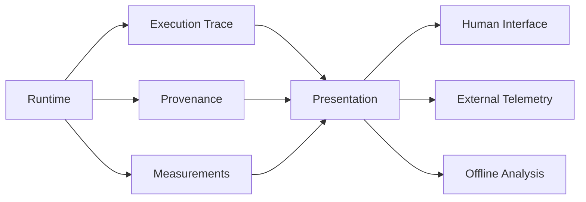

This boundary licenses a guarantee that would otherwise be impossible to state cleanly: suppressing human-facing output does not suppress observation. A caller free to choose how much is shown at a terminal — from nothing at all to a fully detailed rendering of every computational activity, every artifact version, and every recording — is choosing only how the already-complete observation layer is presented, never whether that layer is produced or preserved. Presentation is one consumer among several, standing entirely downstream of an observation layer that is indifferent to whether anything is watching it at all.

### Guarantees

- an execution trace, a provenance record, and a set of instrument recordings remain three structurally distinct views, never collapsible into one another;
- causality is always represented explicitly, through generation and usage relationships between firings and artifact versions — temporal observation order is never treated as a substitute for it;
- an instrument's semantic definition, its contextual binding to a computational role, and any one concrete recording are three identities with three different lifetimes, mirroring the same discipline Section 1 already establishes for computational definitions, participations, and firings;
- the same instrument definition may be reused across different computational roles without conflating their observational series;
- instrumentation is discovered through actual execution rather than declared prospectively as part of composition;
- the logical unit of observation (an instrument) is kept distinct from the physical boundary of isolation and persistence (an execution instance), with cross-execution aggregation layered on top rather than replacing it;
- observation is never conflated with presentation — suppressing what is shown to a human never suppresses tracing, provenance, recording, persistence, or external telemetry, and no presentation failure can ever alter what was computed or what was observed.

---

## Architectural Boundaries

The distinctions that hold this design together, stated as boundaries that must never be collapsed. The first group governs the computational plane (Sections 1-4); the second governs the observation plane (Section 5) and its relationship to the first:

```text
Definition ≠ Composition ≠ Execution
Flow ≠ Run

Domain Value ≠ Artifact State
Artifact Identity ≠ Artifact Version

Shared State ≠ Node-local Memory
Memory ≠ Previous Output

Change Detection ≠ Execution Eligibility
Trigger Policy ≠ Output Observation

Temporal Order ≠ Causality
Execution Trace ≠ Provenance ≠ Instrumentation

Instrument Definition ≠ Instrument Binding ≠ Recording
Observation ≠ Presentation

Logical Observation Unit ≠ Physical Persistence Boundary
```

Each of these boundaries answers a question a reader might otherwise conflate:

- **Definition ≠ Composition ≠ Execution / Flow ≠ Run** — a computation, its place in a topology, and a concrete run of that topology are three different things with three different lifetimes; none of them owns state that belongs to another.
- **Domain Value ≠ Artifact State / Artifact Identity ≠ Artifact Version** — what a transformation computes is not the same as what Reed commits and tracks about it; an artifact's role in the computation is stable while its value changes version by version.
- **Shared State ≠ Node-local Memory / Memory ≠ Previous Output** — only one store is authoritative for any artifact; a node's private continuity and its own last committed result are related but distinct, and neither is visible to any other node.
- **Change Detection ≠ Execution Eligibility / Trigger Policy ≠ Output Observation** — noticing that something changed, deciding whether to act on it, and being notified after acting on it are three separate moments, each with its own rule.
- **Temporal Order ≠ Causality / Execution Trace ≠ Provenance ≠ Instrumentation** — the order in which the runtime observed activities to occur is never a substitute for the explicit generation/usage relationships that establish why a value exists; and the three observational views this architecture maintains — what happened, why a value exists, and what the application chose to measure — each answer a question the other two structurally cannot.
- **Instrument Definition ≠ Instrument Binding ≠ Recording / Observation ≠ Presentation** — a semantic measurement's identity, its association with a specific computational role, and one concrete observation are three distinct identities with three different lifetimes; and what the observation plane produces is never conflated with how, or whether, any of it is shown to a particular consumer.
- **Logical Observation Unit ≠ Physical Persistence Boundary** — the unit at which observations are semantically meaningful (an instrument) is a different concept from the unit at which they are physically isolated and made durable (an execution instance), and conflating them would entangle a purely semantic distinction with a purely operational one.

---

## Summary

Reed rests on two orthogonal planes: a computational plane that decides what is computed and when, and an observation plane, standing beside it rather than after it, that decides what can be reconstructed about that computation without ever changing its outcome.

**Computational Plane**

| Layer | Responsibility |
|---|---|
| Bus Coordination | Structured, causally ordered communication between components. |
| Shared-State Synchronization | One authoritative store of versioned, provenance-carrying artifacts, kept distinct from every node's private local state. |
| Dependency Management | A dependency graph inferred from unambiguous producer-consumer relationships between typed artifacts. |
| Reactive Propagation | Automatic, selective, multi-hop propagation of change through that graph — with execution eligibility, commitment, and observation kept as three distinct, ordered concerns — running to a well-defined quiescent state. |

**Observation Plane**

| Concern | Responsibility |
|---|---|
| Execution Tracing | A chronologically ordered record of computational activity, scoped to one execution instance. |
| Data Provenance | Explicit generation/usage relationships between firings and artifact versions, standing in for temporal order wherever causality is the real question. |
| Instrumentation | Domain-specific quantities the application chose to observe, discovered rather than declared, and consumed by presentation without ever influencing what was computed. |

Together, these layers let Reed coordinate interdependent computation the way a reader would want a dataflow system to work: composition stays separate from execution; artifacts carry a clear identity, version, and provenance; state has exactly one authoritative home; a single change can safely and predictably cascade through everything that actually depends on it and nothing else; and everything the computational plane does can be observed, traced, and reconstructed afterward without that observation ever being able to feed back into what was computed.
