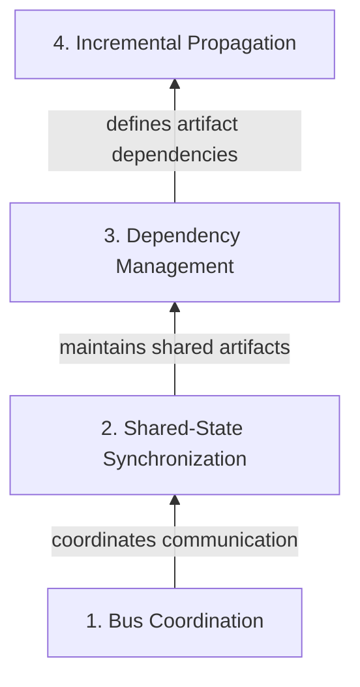
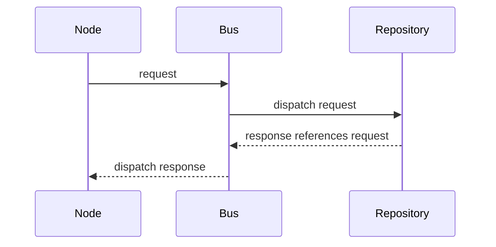
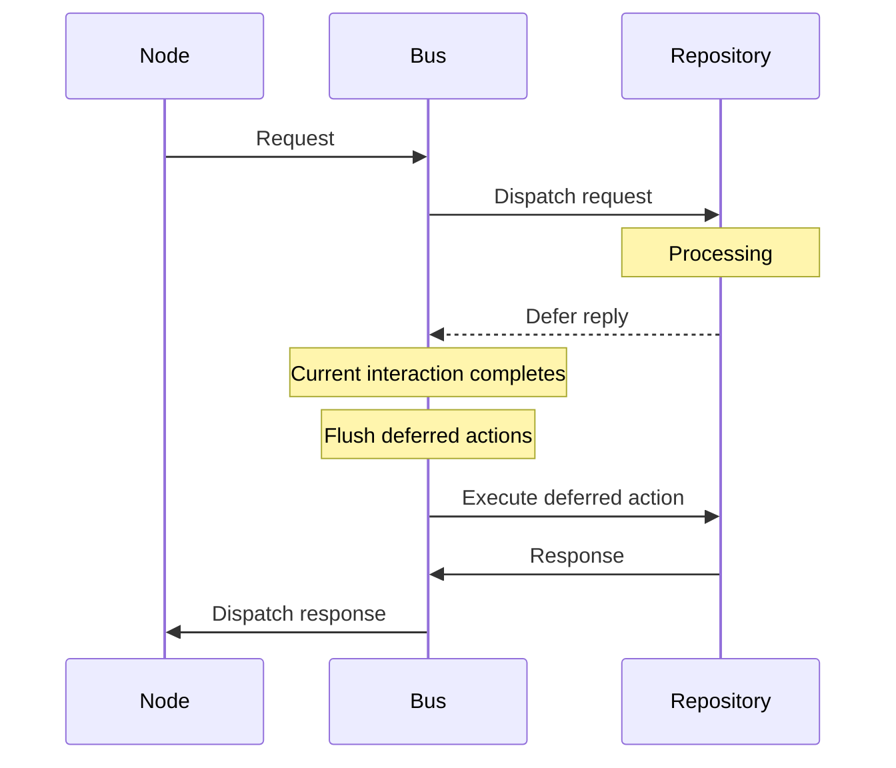
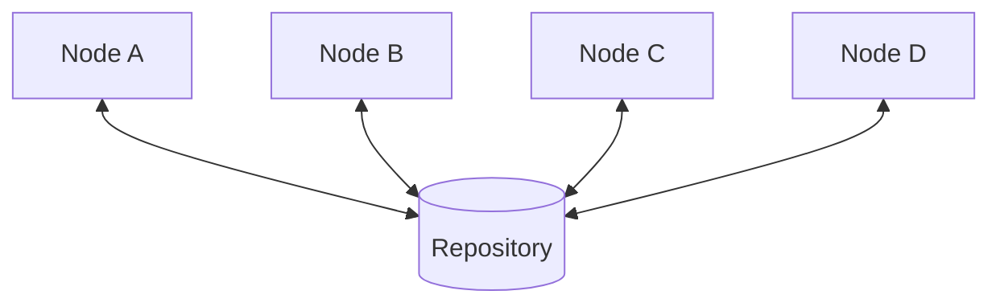
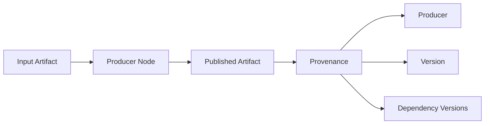
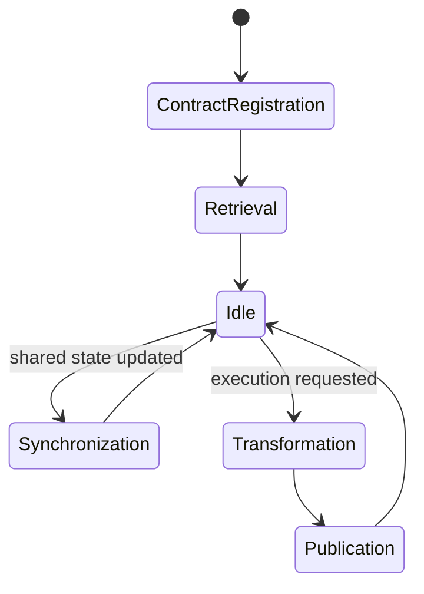
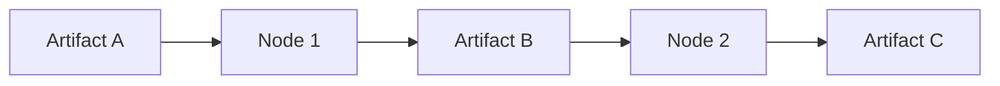
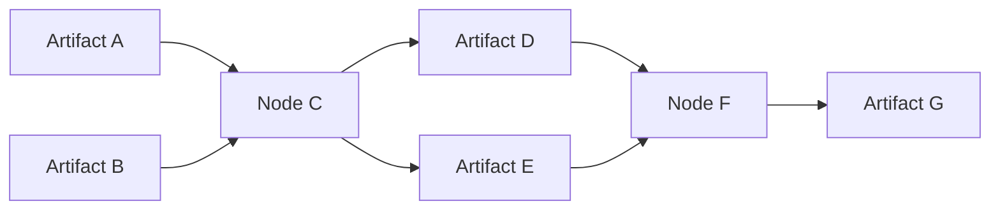
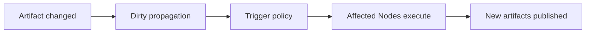
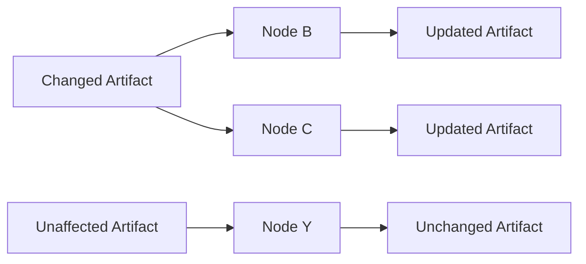

# Reed Architecture

Reed is a computational framework for coordinating interdependent transformations through shared state, explicit artifact dependencies, and structured communication.

The architecture is organized into four layers, from the most internal mechanism to the most external behavior:

1. **Bus Coordination**
2. **Shared-State Synchronization**
3. **Dependency Management**
4. **Incremental Propagation**



Each layer answers a different architectural question:

| Layer | Question |
|---|---|
| Bus Coordination | How do components communicate? |
| Shared-State Synchronization | Where does shared truth live? |
| Dependency Management | What depends on what? |
| Incremental Propagation | What must react when something changes? |

---

## Architectural Principles

### Single Source of Truth

Reed maintains shared artifacts through a centralized **Repository**.

The Repository is not just storage. It is the authoritative source for shared state.

Nodes may keep local state, but local state is not authoritative.

### Producer-Consumer Organization

Reed models computation through a producer-consumer organization.

A **Node** consumes artifacts and produces new artifacts.

This defines the primary responsibility of a Node: transforming declared inputs into declared outputs.

### Artifact-Oriented Dataflow

Reed is organized around artifacts, not around manual call sequences.

Execution follows relationships between artifacts:

```text
Artifact A -> Node 1 -> Artifact B -> Node 2 -> Artifact C
```

A **Flow** is the composition boundary that groups Nodes and artifacts into an executable dataflow context.

### Unique Producer Responsibility

Each artifact has exactly one responsible producer Node within a Flow.

That same Node is also responsible for maintaining the artifact over time.

This principle is central to Reed's mental model:

```text
If an artifact exists in the shared state, one Node is responsible for producing and maintaining it.
```

The artifact's type describes what kind of value it carries.

The artifact's identity describes its role in the computation, including who is responsible for producing and maintaining it.

### Shared And Local State Separation

Reed distinguishes two notions of state:

| State | Meaning |
|---|---|
| Shared State | Authoritative state maintained by the Repository. |
| Local State | Node-local view or working state synchronized with the Repository. |

This separation allows Nodes to compute locally while preserving a consistent shared state.

### Causal Ordering

Reed preserves causal ordering between communication interactions.

Communication side effects produced while handling one message are delayed until the current interaction has completed.

This prevents recursive message handling from blurring cause and effect.

### Selective Recomputation

Reed avoids recomputing the whole graph when a local change occurs.

Instead, changes are propagated through the affected part of the dependency graph.

Only computations whose inputs are affected should become eligible for re-execution.

---

## 1. Bus Coordination

### Purpose

Bus Coordination defines how Reed components communicate.

It provides structured message delivery, topic-based routing, communication context, trace identifiers, and split-phase execution.

### Core Concepts

| Concept | Meaning |
|---|---|
| Bus | Communication mechanism used to route messages between components. |
| Topic | Semantic channel associated with a kind of interaction. |
| Message | Payload describing an operation or transmitted data. |
| Communication Context | Metadata required to coordinate delivery and causality. |
| Trace Identifier | Identifier associated with one communication interaction. |

### Topics

Interactions are organized into semantic topics.

Examples include:

```text
contract
retrieve
synchronize
publish
```

A component may expose multiple communication endpoints while maintaining a single identity in the system.

Routing is determined by:

- sender identity;
- recipient identity;
- communication topic.

### Message Structure

Every message has two conceptual parts:

```text
Message
├── Payload
└── Communication Context
```

The **payload** describes the requested operation or transmitted data.

The **communication context** carries coordination metadata, such as:

```text
sender
recipient
topic
trace_identifier
reply_to
```

Replies form new interactions with their own trace identifiers, while referencing the original interaction through `reply_to`.



### Split-Phase Execution

Bus communication follows a **split-phase execution model**.

Each interaction has two phases:

1. **Processing**
2. **Flush / Post-processing**

During processing, the receiver handles the current message and computes a local result.

Communication side effects generated during processing are not emitted immediately.

They are deferred until the current interaction completes.



### Guarantees

Bus Coordination preserves:

- causal ordering;
- explicit interaction boundaries;
- deterministic message processing;
- traceable request-response chains.

---

## 2. Shared-State Synchronization

### Purpose

Shared-State Synchronization maintains a consistent shared state across Nodes.

Nodes do not act as independent authoritative sources of state.

They synchronize with the Repository, which acts as Reed's Single Source of Truth.



### Core Concepts

| Concept | Meaning |
|---|---|
| Repository | Authoritative store of shared artifacts. |
| Artifact | Computational product stored in shared state. |
| Shared State | Global state maintained by the Repository. |
| Local State | Node-local view synchronized with shared state. |
| Provenance | Metadata describing how an artifact was produced. |

### Artifact Publication

When a Node completes a transformation, it publishes produced artifacts to the Repository.

Publication makes the Repository authoritative for the new artifact state.

Publication also records **provenance**.

Provenance describes:

- the responsible producer;
- the artifact version;
- the artifact versions consumed to produce it.



### Node Lifecycle

Interaction between a Node and the Repository follows a lifecycle:

1. **Contract Registration**
2. **Retrieval**
3. **Synchronization**
4. **Transformation**
5. **Publication**
6. **Idle**



### Lifecycle Phases

| Phase | Meaning |
|---|---|
| Contract Registration | The Node declares which artifacts it consumes and produces. |
| Retrieval | The Node retrieves artifacts required to initialize its local state. |
| Idle | The Node waits for relevant state changes or execution requests. |
| Synchronization | The Node refreshes local state after relevant shared-state updates. |
| Transformation | The Node computes using its declared inputs. |
| Publication | The Node publishes produced artifacts and provenance. |

### Guarantees

Shared-State Synchronization preserves:

- one authoritative shared state;
- clear separation between shared state and local state;
- explicit publication boundaries;
- provenance for published artifacts.

---

## 3. Dependency Management

### Purpose

Dependency Management defines relationships between artifacts.

It answers:

```text
What depends on what?
```

Artifacts produced by a computational workflow may depend on other artifacts.

Reed represents these relationships as an artifact dependency graph.

### Producer-Consumer Graph

Nodes participate in the graph as producer-consumer units.

A Node consumes artifacts and produces artifacts.



The graph may contain branches and joins:



### Unique Producer Responsibility

Each artifact has a single responsible producer Node.

That producer is also the artifact's maintainer within the Flow.

This prevents ambiguity in the dependency graph.

When another Node consumes an artifact, it consumes a value whose production and maintenance responsibility is known.

```text
Artifact identity = value role + responsible producer + position in the computation
```

The artifact's data type is not enough to define its architectural identity.

Two artifacts may carry the same kind of value while occupying different roles in the computation.

### Flow Boundary

A Flow groups Nodes and artifacts into a composition boundary.

Within that boundary, Reed can reason about:

- which artifacts exist;
- which Nodes produce them;
- which Nodes consume them;
- how changes may affect downstream computations.

This does not require the user to manually define an execution sequence.

The execution order emerges from artifact dependencies.

### Guarantees

Dependency Management preserves:

- explicit artifact dependencies;
- producer-consumer responsibility;
- unambiguous artifact ownership;
- separation between data type and artifact identity.

---

## 4. Incremental Propagation

### Purpose

Incremental Propagation determines which computations must react when an artifact changes.

It answers:

```text
What must react when something changes?
```

Instead of recomputing the entire Flow, Reed propagates change information through the affected portion of the dependency graph.

### Core Concepts

| Concept | Meaning |
|---|---|
| Dirty Flag | Marker indicating that an artifact or dependency is no longer up to date. |
| Dirty Propagation | Process of spreading invalidation through affected dependencies. |
| Trigger Policy | Rule that determines when a Node should execute in response to changes. |
| Selective Recomputation | Re-execution of only the affected computations. |

### Dirty Propagation

When an artifact changes, dependent artifacts may become outdated.

Reed marks affected dependencies as dirty and propagates that information downstream.



Dirty propagation separates two concerns:

- **invalidation**, which identifies what became outdated;
- **execution**, which decides what should run.

### Trigger Policy

A Trigger Policy determines whether a Node should execute after dependency changes.

Examples of possible policies include:

- execute when any dependency changes;
- execute only when all dependencies have changed;
- execute only when explicitly requested.

The policy belongs to the reactive behavior of the graph, not to the artifact itself.

### Selective Recomputation

Selective recomputation is the practical result of incremental propagation.

If a change affects only one branch of the graph, Reed should only activate that branch.



### Guarantees

Incremental Propagation preserves:

- localized reaction to change;
- automatic downstream invalidation;
- policy-driven activation;
- avoidance of unnecessary recomputation.

---

## Summary

Reed combines four architectural layers:

| Layer | Responsibility |
|---|---|
| Bus Coordination | Preserves structured communication and causal ordering. |
| Shared-State Synchronization | Maintains the Repository as the Single Source of Truth. |
| Dependency Management | Defines artifact relationships and producer responsibility. |
| Incremental Propagation | Propagates changes and activates affected computations. |

Together, these layers allow Reed to coordinate interdependent transformations while preserving explicit dependencies, shared-state consistency, provenance, causal communication, and selective recomputation.
