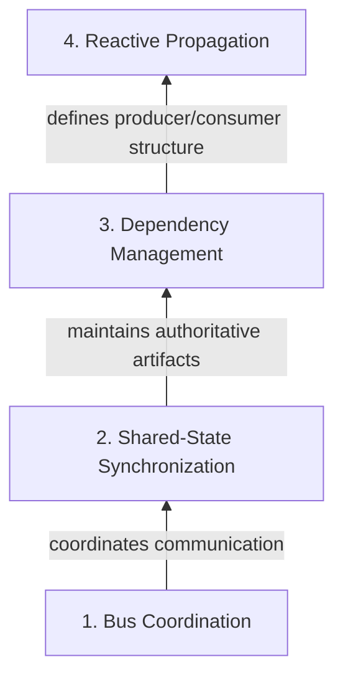
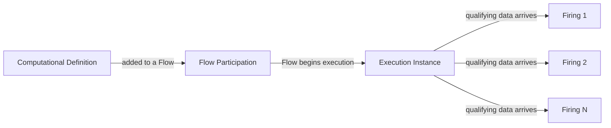
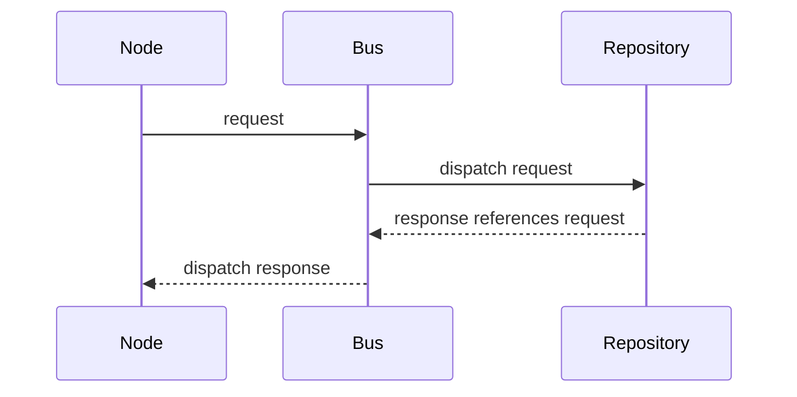
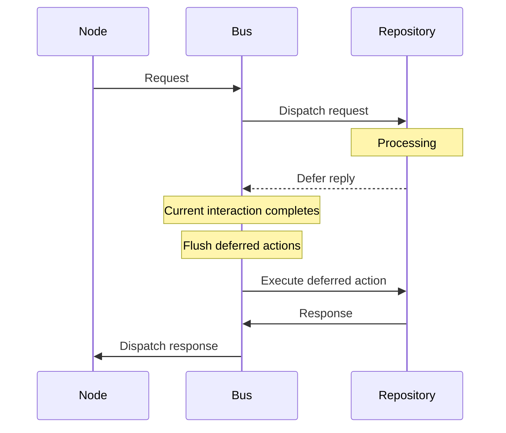
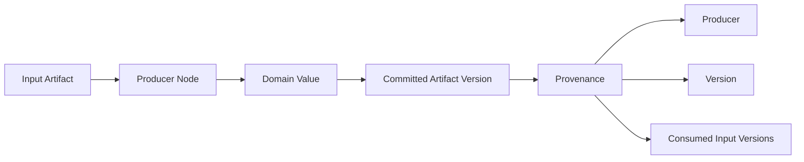
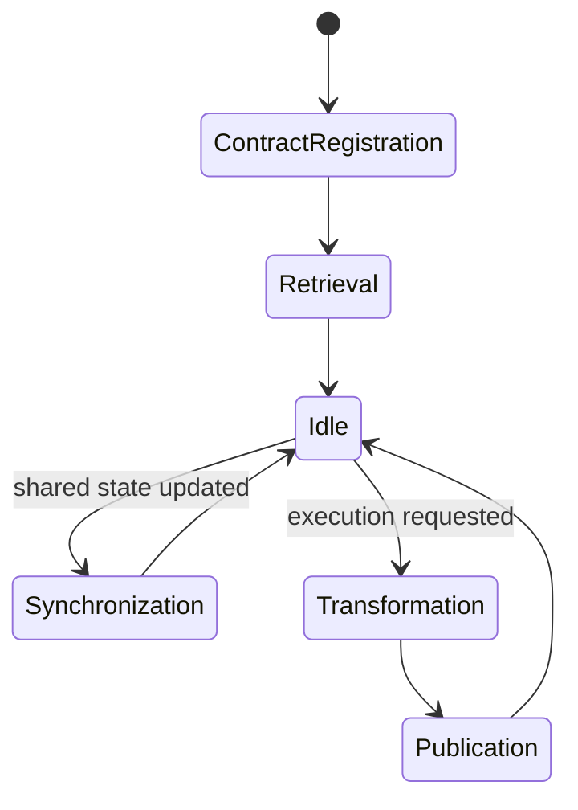
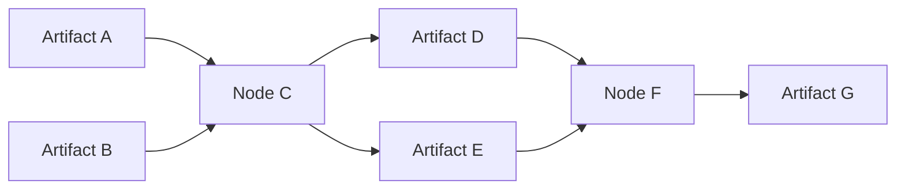
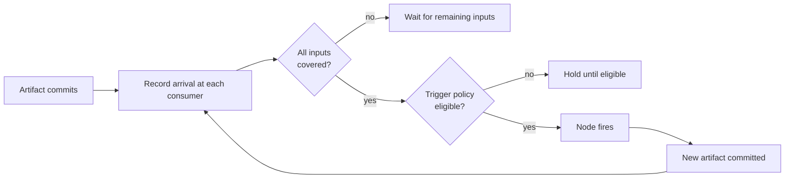
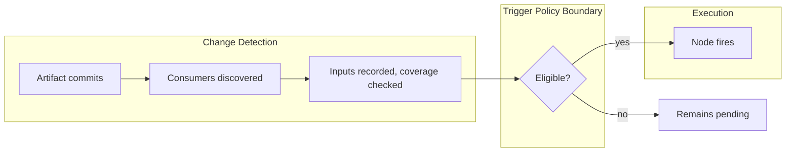
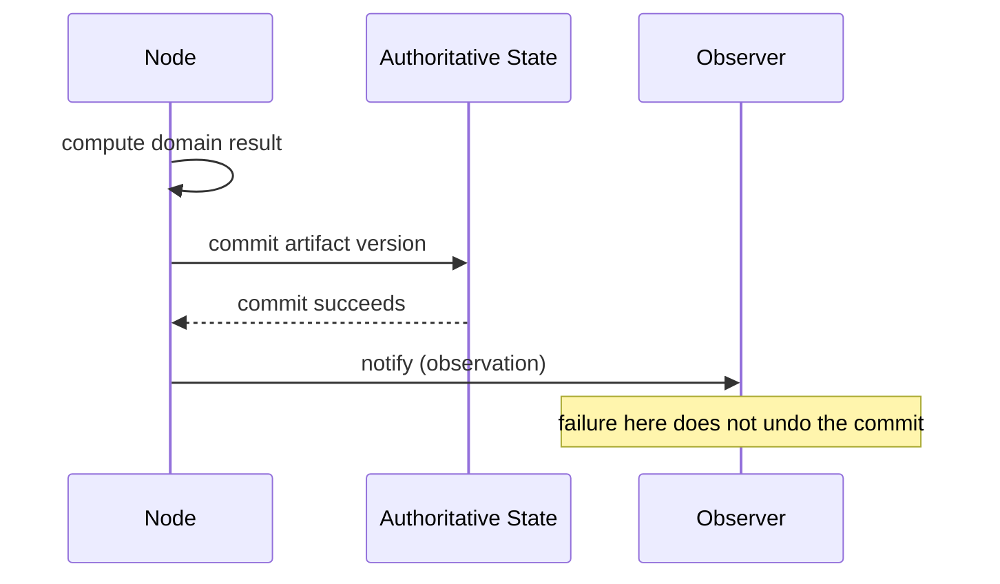

# Reed Architecture

Reed is a computational framework for coordinating interdependent transformations through typed artifacts, explicit dependency structure, and reactive propagation. A user models a domain as a set of typed values and the transformations between them; Reed turns that model into an executable dataflow, decides what must recompute when something changes, and keeps a single authoritative record of every artifact it produces along the way.

This document describes Reed's architecture at the level of concepts and mechanisms that would survive a reimplementation in different classes or data structures. Concrete names appear only for orientation.

---

## Architectural Overview

Reed's design rests on three ideas held apart on purpose:

1. **Composition is not execution.** Defining a computation, wiring it into a dataflow, and actually running it are three different scopes with three different lifetimes.
2. **A value is not the same thing as an artifact.** The domain value a transformation returns is distinct from the identity, version, and provenance Reed attaches to it once it is committed.
3. **Noticing a change is not deciding to act on it.** Change propagates through the dependency graph continuously; whether that propagation causes a node to execute is a separate, explicit policy decision.

These three separations recur throughout the architecture and are the basis for the four layers below.



| Layer | Question it answers |
|---|---|
| Bus Coordination | How do components communicate? |
| Shared-State Synchronization | Where does authoritative truth live, and what is merely local? |
| Dependency Management | What depends on what? |
| Reactive Propagation | What must react when something changes, and when? |

---

## Architectural Principles

### Composition and Execution Are Separate Lifecycle Scopes

Reed distinguishes four nested scopes, each strictly contained in the next:

```text
Computational Definition -> Flow Participation -> Execution Instance -> Individual Firing
```

- A **computational definition** is a reusable unit of computation — a typed transformation from declared inputs to a declared output. It carries no notion of any particular flow or run.
- **Participation in a Flow** is what happens when a definition is added to a composition boundary (a **Flow**). The same definition may participate in more than one Flow, or in principle more than once in the same Flow; participation gives it a place in a topology, not a copy of its logic.
- An **execution instance** (a **Run**) is one concrete execution of a Flow. Two Runs of the same Flow share no state: each gets its own authoritative artifact store and its own materialized runtime for every participating node.
- An **individual firing** is one execution attempt of one node's participation, inside one Run. A node's participation may fire many times over the life of a Run — once per qualifying arrival of new data.

This separation exists so that a reusable computation never accidentally carries state across unrelated Flows or unrelated Runs, and so that concurrent or repeated Runs of the same Flow are independent by construction rather than by convention.



### Producer-Consumer Organization

Reed models computation as a graph of typed artifacts flowing between producers and consumers. A node consumes some artifacts and produces one artifact; execution order is never stated by the user — it is inferred from which artifacts exist and which nodes need them.

```text
Artifact A -> Node 1 -> Artifact B -> Node 2 -> Artifact C
```

### Unique Producer Responsibility

Within one Flow, each artifact has exactly one node responsible for producing — and, over the life of a Run, maintaining — it. This is what allows Reed to infer a dependency graph purely from a Flow's composition: if an artifact exists, there is exactly one place its next version can come from. A node may not both consume and produce the same artifact identity; a stage that appears to transform a value into "more of the same" must be expressed as a new, distinct downstream identity instead.

### Shared and Local State Separation

Reed distinguishes two notions of state that must never be confused:

| State | Meaning |
|---|---|
| Authoritative (shared) state | The current, committed value of every artifact in a Run — the only state other nodes, and the outside world, can observe. |
| Node-local state | Private computational continuity a node keeps for itself, and a synchronized view of its own most recent committed result. Never authoritative for anyone but that node. |

A node may consult and update its own local state freely; it can never make that state visible to, or authoritative for, any other node.

### Change Detection Is Not Execution Eligibility

An artifact changing does not by itself mean anything should run. Change establishes that dependents *may* be out of date; a separate, explicit **trigger policy** decides whether that possibility becomes an actual execution. This is the architectural boundary between "something happened" and "this should now run."

### Selective, Reactive Recomputation

Reed does not recompute a whole Flow when one artifact changes. A change propagates only through the part of the dependency graph that is actually reachable from it, and only nodes whose trigger policy judges them eligible actually fire. Propagation continues, hop after hop, until no further node becomes eligible — a **quiescent** state.

---

## 1. Bus Coordination

### Purpose

Bus Coordination is the substrate of communication: how requests, responses, and updates move between components without components needing direct references to each other.

### Core Concepts

| Concept | Meaning |
|---|---|
| Bus | The communication mechanism that routes messages between components. |
| Topic | A semantic channel associated with a kind of interaction (e.g. contract, retrieve, synchronize, publish). |
| Message | A payload describing an operation or carrying data, paired with communication context. |
| Communication Context | Metadata needed to route and causally order a message: sender, recipient, topic, trace identifier, reply-to. |



### Split-Phase Execution and Causal Ordering

Every interaction has two phases: **processing**, in which a receiver computes a local result, and **flush**, in which any communication side effects that processing generated are actually emitted. Side effects produced while handling one message are deferred until that interaction completes, rather than emitted immediately and recursively.



This keeps cause and effect distinguishable even when a reaction to one message would otherwise trigger another message inline, and it gives every interaction a traceable identity.

### Guarantees

- causal ordering between interactions;
- explicit, non-recursive interaction boundaries;
- deterministic message processing;
- traceable request/response chains.

---

## 2. Shared-State Synchronization

### Purpose

This layer establishes where authoritative truth lives, and how a node's private view of the world stays consistent with it.

### The Artifact Model

Reed distinguishes several things that a less careful design would collapse into one:

| Concept | Meaning |
|---|---|
| Domain value | The plain value a transformation actually computes — what the user's code sees and returns. |
| Artifact identity | What role that value plays in the computation: which position in the dependency graph it occupies, and who is responsible for producing and maintaining it. In Reed, the domain **type** *is* the artifact's semantic identity — two values of the same type occupying different computational roles must be given different types. |
| Artifact version | One committed instance of an artifact's value over time. Identity is stable across a Run; version changes every time the responsible node commits a new value. |
| Provenance | Metadata recorded alongside a committed version: which node produced it and which versions of its own inputs it was produced from. |
| Authoritative artifact state | The current committed version of an artifact, held by the one place in a Run that is allowed to be authoritative for it. |



A user node never manipulates artifact identity, versions, or provenance directly — it consumes and returns plain domain values. Reed derives artifact identity from the value's type, wraps and unwraps it at the node boundary, and manages versioning and provenance entirely on its own. This lets application code stay purely about domain meaning while Reed's execution machinery remains free to evolve underneath it.

### Node Lifecycle

A node's participation in a Run moves through a small number of phases:



| Phase | Meaning |
|---|---|
| Contract Registration | The node declares which artifact types it consumes and which it produces. |
| Retrieval | The node's participation is materialized and given whatever local state it needs to begin. |
| Idle | The node's participation waits for relevant artifact changes or an explicit execution request. |
| Synchronization | Newly arrived values relevant to this node are recorded. |
| Transformation | The node computes a new domain value from its currently available inputs. |
| Publication | The produced value is wrapped into a versioned artifact and committed to authoritative state, with provenance. |

### Guarantees

- exactly one authoritative store of committed artifact state per execution instance;
- a firm separation between authoritative and local state;
- every committed artifact carries provenance;
- publication is an explicit, observable boundary — nothing becomes authoritative silently.

---

## 3. Dependency Management

### Purpose

Dependency Management answers what depends on what, purely from a Flow's composition — never from a manually declared execution order.

### Producer-Consumer Graph

Nodes are edges between artifact-typed nodes in a graph: each node consumes some artifact types and produces one. The graph may branch (one artifact feeding several independent consumers) and join (one node consuming several artifacts at once):



### Unique Producer Responsibility, Revisited

Because each artifact type has exactly one producer within a Flow, the dependency graph is unambiguous by construction: consuming an artifact of a given type always means consuming a value whose origin and maintenance responsibility are already known. A Flow that would introduce two producers for the same artifact type, or a node that would consume and produce the same type, is rejected when the Flow is composed — before any execution takes place.

```text
Artifact identity = value role + responsible producer + position in the computation
```

An artifact's data type alone is not its full identity; two values with the same shape but different roles in the computation must be modeled as different types, so that the graph Reed infers reflects the computation's actual structure.

### Flow Boundary

A Flow is the composition boundary within which Reed can answer: which artifacts exist, which node produces each, which nodes consume each, and — from that — what would be affected if any one artifact changed. None of this requires the user to state an execution order; order is a consequence of the graph, not an input to it.

### Guarantees

- explicit, inferred artifact dependencies;
- unambiguous producer responsibility for every artifact;
- rejection of ambiguous or self-referential producer relationships at composition time, before execution;
- a firm separation between an artifact's data type and its architectural identity.

---

## 4. Reactive Propagation

### Purpose

This layer determines what must react when an artifact changes, and governs the mechanism by which a single committed value can cause a cascade of further computation across the whole reachable dependency graph, until nothing more is eligible to run.

### Core Concepts

| Concept | Meaning |
|---|---|
| Change | A new committed version of an artifact becoming available. |
| Execution eligibility | Whether a node whose inputs have changed is actually allowed to fire now. |
| Trigger policy | The rule, attached to one node's participation in a Flow, that decides eligibility from the pattern of which of its inputs have changed. |
| Commit | The act of making a produced value the new authoritative version of its artifact. |
| Observation | External notice of a commit, strictly after it has happened. |
| Quiescence | The state reached when no further node is eligible to fire — propagation has run to completion. |

### The Reactive Cycle

A single published value is the seed of a cascade, not a one-shot call. Each committed artifact is checked against every node that consumes its type; for each such node, Reed records the arriving value, checks whether every one of that node's declared inputs now has some known value (a node can never be called with a missing input), and only then consults that node's trigger policy to decide eligibility. An eligible node fires using the most recent known value for each of its inputs, its result is committed, and that commit in turn seeds the same check for its own consumers. The cascade continues, hop after hop, until no pending value produces a newly eligible node — the graph reaches quiescence.



This single mechanism accounts for everything the reactive model needs to support:

- **Automatic multi-hop propagation** — a commit at one node can cause a chain of further commits several hops downstream, without any of it being restated by the caller.
- **Branching / fan-out** — one committed artifact can make more than one downstream node eligible at once; each is considered independently.
- **Multi-input joins** — a node with several declared inputs is only ever fired once every one of them has a known value, and (depending on its policy) only once the relevant inputs have changed since its last firing.
- **Repeated updates** — a node's participation can fire many times across a Run's life, once per qualifying new arrival; nothing about the mechanism assumes a single firing per node.
- **Quiescence** — because propagation is driven by a queue of pending commits that is processed until empty, a cascade always terminates once nothing further becomes eligible, giving the Run a well-defined settled state after each externally introduced change.

### Trigger Policy: Change Is Not Execution

Full coverage of a node's inputs is necessary but not sufficient for it to fire. A trigger policy is the second, independent gate:

- fire on *any* input changing, once every input has at least some value;
- fire only once *every* input has changed since the node's last firing (a true join semantics, reset after each firing);
- never fire automatically — only in response to an explicit request.

The trigger policy belongs to the node's participation in the Flow, not to the artifact type or to the reactive mechanism itself; it is the one place application-specific eligibility logic lives, keeping "did something change" and "should this run now" strictly separate concerns.



### Commit, Then Observation

A firing computes a plain domain result; Reed commits the corresponding artifact version to authoritative state; only after that commit succeeds does any external observer — a callback, a downstream log, a UI — get to see the value. Observation never precedes or substitutes for commitment, and a failure in an observer cannot retroactively undo a commit that already happened: computation, commitment, and observation are three distinct, ordered stages, and a fault in the last never contaminates the first two.



### Guarantees

- localized reaction to change — only the reachable, eligible part of the graph is ever recomputed;
- automatic downstream propagation across arbitrarily many hops, including branches and joins;
- a strict separation between change detection, execution eligibility, and observation;
- a well-defined, reachable quiescent state after any externally introduced change;
- observation strictly follows successful commitment, and never the reverse.

---

## Architectural Boundaries

The distinctions that hold this design together, stated as boundaries that must never be collapsed:

```text
Definition ≠ Composition ≠ Execution
Flow ≠ Run

Domain Value ≠ Artifact State
Artifact Identity ≠ Artifact Version

Shared State ≠ Node-local Memory
Memory ≠ Previous Output

Change Detection ≠ Execution Eligibility
Trigger Policy ≠ Output Observation
```

Each of these boundaries answers a question a reader might otherwise conflate:

- **Definition ≠ Composition ≠ Execution / Flow ≠ Run** — a computation, its place in a topology, and a concrete run of that topology are three different things with three different lifetimes; none of them owns state that belongs to another.
- **Domain Value ≠ Artifact State / Artifact Identity ≠ Artifact Version** — what a transformation computes is not the same as what Reed commits and tracks about it; an artifact's role in the computation is stable while its value changes version by version.
- **Shared State ≠ Node-local Memory / Memory ≠ Previous Output** — only one store is authoritative for any artifact; a node's private continuity and its own last committed result are related but distinct, and neither is visible to any other node.
- **Change Detection ≠ Execution Eligibility / Trigger Policy ≠ Output Observation** — noticing that something changed, deciding whether to act on it, and being notified after acting on it are three separate moments, each with its own rule.

---

## Summary

Reed combines four architectural layers into one coherent model:

| Layer | Responsibility |
|---|---|
| Bus Coordination | Structured, causally ordered communication between components. |
| Shared-State Synchronization | One authoritative store of versioned, provenance-carrying artifacts, kept distinct from every node's private local state. |
| Dependency Management | A dependency graph inferred from unambiguous producer-consumer relationships between typed artifacts. |
| Reactive Propagation | Automatic, selective, multi-hop propagation of change through that graph — with execution eligibility, commitment, and observation kept as three distinct, ordered concerns — running to a well-defined quiescent state. |

Together, these layers let Reed coordinate interdependent computation the way a reader would want a dataflow system to work: composition stays separate from execution; artifacts carry a clear identity, version, and provenance; state has exactly one authoritative home; and a single change can safely and predictably cascade through everything that actually depends on it — and nothing else.
