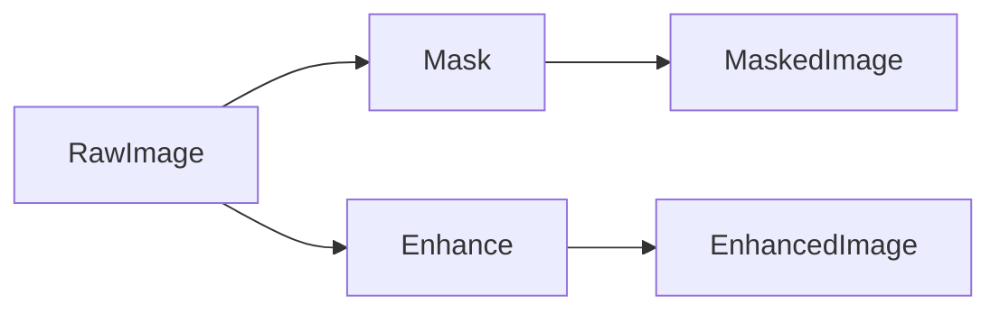

# Parcel Boundary Decision

This document records the conceptual decision for Reed's public node boundary and its internal Parcel model.

The decision is focused on the relationship between user-defined domain types, artifacts, Parcels, Nodes, Flows, and Runs. It does not introduce an implementation plan by itself.

## Decision

Reed will move toward a public API where user nodes consume and produce domain values, while Reed internally wraps those values into Parcels.

The target public shape is:

```python
def my_node(input_value: InputType) -> OutputType:
    ...

flow = Flow()
flow.add(my_node)
flow.run()
```

The user-facing node boundary should not require direct Parcel types.

Instead, Reed derives the internal artifact and Parcel model from the function signature:

```text
InputType -> Parcel[InputType]
OutputType -> Parcel[OutputType]
```

The core rule is:

```text
Nodes consume and produce domain values.
Reed consumes and produces Parcels.
```

This keeps Parcel as an execution concept owned by Reed, while preserving a clean domain model for the application author.

## Core Thesis

Reed is a strongly typed artifact system.

In Reed, a user-defined type is not only a data shape. It is also the semantic identity of an artifact inside a Flow.

```text
Domain Type == Artifact Semantic Identity
Parcel[Domain Type] == Reed's internal execution envelope for that artifact
```

This gives Reed a stronger model than APIs based only on names, string keys, or loosely identified values.

If two values have the same representation but different meanings in the computation, the user should express that distinction through different domain types.

For example:

```python
class Image:
    ...

class RawImage(Image):
    ...

class DenoisedImage(Image):
    ...

def load_raw_image() -> RawImage:
    ...

def denoise_image(image: RawImage) -> DenoisedImage:
    ...
```

The Flow inferred by Reed is:

```text
RawImage -> DenoisedImage
```

The following shape should not be treated as a good Reed model:

```python
def load_raw_image() -> Image:
    ...

def denoise_image(image: Image) -> Image:
    ...
```

This signature suggests that the same artifact identity is both consumed and produced. In Reed's model, this is a self-flow at the artifact type level:

```text
Image -> Image
```

If the input and output have different meanings, they should have different domain types.

## Unique Producer Responsibility

Inside one Flow, each artifact type has exactly one producer Node.

```text
One artifact type has exactly one producer Node inside a Flow.
```

This is a central architectural identity for Reed.

If an artifact exists in a Flow, there is exactly one place responsible for producing and maintaining it.

This gives Reed:

1. no ambiguity about artifact origin;
2. no ambiguity about maintenance responsibility;
3. a directly inferable dependency graph;
4. clearer invalidation and recomputation rules;
5. stronger observability and failure isolation.

The following case must be rejected during Flow construction:

```python
def node_1(value: MyType1) -> MyType2:
    ...

def node_2(value: MyType1) -> MyType2:
    ...
```

Both nodes attempt to produce the same artifact type:

```text
MyType2
```

That creates an ambiguous producer relationship. Reed should raise an error before execution.

## No Self-Flow

A Node should not consume and produce the same artifact type.

This should be rejected:

```python
def transform(image: Image) -> Image:
    ...
```

In Reed's model, the type is the artifact identity. A signature like this says:

```text
Image -> Image
```

That means the Node consumes and produces the same artifact identity.

If the transformation creates a new semantic stage, that stage should be represented as a new type:

```python
class InputImage(Image):
    ...

class ProcessedImage(Image):
    ...

def transform(image: InputImage) -> ProcessedImage:
    ...
```

This preserves Reed's ability to infer a meaningful graph from type annotations.

## Parcel As Internal Envelope

Parcel remains a first-class Reed concept, but it should not be the default public boundary for user-defined Nodes.

The user owns the domain value:

```text
RawImage
DenoisedImage
MaskedImage
EnhancedImage
DronePosition
SimulationFrame
```

Reed owns the execution envelope:

```text
Parcel[RawImage]
Parcel[DenoisedImage]
Parcel[MaskedImage]
Parcel[EnhancedImage]
Parcel[DronePosition]
Parcel[SimulationFrame]
```

Conceptually:

```text
Domain value != Parcel
Domain type == Artifact semantic identity
Parcel == Reed execution envelope
```

The boundary can be described as:

```text
unwrap: Parcel[T] -> T
node: T -> U
wrap: U -> Parcel[U]
```

Or:

```text
Parcel[T] -> unwrap -> T -> node -> U -> wrap -> Parcel[U]
```

This allows user code to stay focused on application meaning while Reed handles identity, versions, tracing, synchronization, publication, triggering, and dependency propagation.

## Domain And Infrastructure Separation

Reed separates the application domain from the execution infrastructure.

Users model their domain with strongly typed artifacts and transformations between them.

Reed derives the Flow from those type relationships, wraps domain values into Parcels, executes Nodes, tracks versions, emits traces, and decides when downstream artifacts must be recomputed.

The guiding principle is:

```text
The user owns domain meaning.
Reed owns execution semantics.
```

For a simulation, the user domain may contain concepts such as:

```text
DronePosition
SensorReading
SimulationFrame
CollisionMap
TrajectoryEstimate
```

Reed should not force these concepts to inherit its infrastructure vocabulary at the public Node boundary.

The user should write domain transformations:

```python
def estimate_trajectory(position: DronePosition) -> TrajectoryEstimate:
    ...
```

Reed should internally represent the produced artifact as:

```text
Parcel[TrajectoryEstimate]
```

## Parallel Execution Consequence

Strong artifact identity gives Reed a natural path toward safe parallel execution.

For example:

```python
class MaskedImage(Image):
    ...

class EnhancedImage(Image):
    ...

def mask(image: RawImage) -> MaskedImage:
    ...

def enhance(image: RawImage) -> EnhancedImage:
    ...
```

Reed can infer:

```text
RawImage -> MaskedImage
RawImage -> EnhancedImage
```

The two Nodes consume the same artifact and produce different artifact types.

That makes them eligible for parallel execution once `RawImage` is available:



There is no write collision between `mask` and `enhance`, since each Node is responsible for a different output artifact type.

This gives Reed a future execution model where parallelism can be discovered from the type graph instead of manually declared through locks, queues, or imperative scheduling.

## Observability Consequence

The same model strengthens observability.

If each artifact type has one producer, then each produced Parcel can be linked to a precise Node execution.

This makes the following metadata easier to reason about:

1. trace identifier;
2. span identifier;
3. artifact version;
4. producing Node;
5. consumed input versions;
6. triggering decision;
7. execution duration;
8. failure cause.

For example:

```text
RawImage --[span: mask]--> MaskedImage
RawImage --[span: enhance]--> EnhancedImage
```

If `MaskedImage` fails to materialize, the investigation starts at `mask`.

If `EnhancedImage` is stale, the investigation starts at `enhance`.

If `RawImage` changes, Reed can identify the affected downstream artifact types through the inferred Flow topology.

This isolates problems at the Node boundary and keeps execution diagnostics connected to domain-level artifact names.

## Recommended Initial API Rule

The initial target API should follow these rules:

1. A user Node is a typed Python callable.
2. Parameter annotations define consumed artifact types.
3. The return annotation defines the produced artifact type.
4. Reed derives internal Parcel types from those artifact types.
5. A Flow rejects two Nodes that produce the same artifact type.
6. A Flow rejects a Node that consumes and produces the same artifact type.
7. Explicit Parcel-based APIs may remain available as an escape hatch for advanced Reed internals.

Example:

```python
class RawImage(Image):
    ...

class MaskedImage(Image):
    ...

class EnhancedImage(Image):
    ...

def mask(image: RawImage) -> MaskedImage:
    ...

def enhance(image: RawImage) -> EnhancedImage:
    ...

flow = Flow()
flow.add(mask)
flow.add(enhance)
flow.run()
```

Reed infers:

```text
RawImage -> MaskedImage
RawImage -> EnhancedImage
```

And internally uses:

```text
Parcel[RawImage]
Parcel[MaskedImage]
Parcel[EnhancedImage]
```

## Conceptual Tradeoff

This decision favors strong modeling over permissive composition.

The benefit is that Reed can infer the graph, prevent producer ambiguity, isolate failures, support future parallel execution, and attach observability metadata to a precise artifact lineage.

The cost is that users must define meaningful domain types for meaningful artifact stages.

This is an acceptable cost for Reed because the framework is designed around strongly typed computational artifacts, not ad hoc value passing.

The type system becomes part of the architecture:

```text
If two artifacts mean different things, they should have different types.
```

## Relationship To Prior Work

This decision is aligned with the broader direction found in recognized workflow and graph systems, while preserving Reed's own identity.

LangGraph provides a useful public API reference for explicit graph composition, where callables are added to a graph and the graph becomes the composition boundary.

Dagster and Kedro separate user computation from orchestration concerns, but they usually identify artifacts through asset keys, dataset names, or pipeline names.

Hamilton derives dependency structure from Python functions and type annotations, but its primary artifact identity is tied to function and parameter names.

Parsl, Dask, Prefect, and Ray show the value of separating user values from execution carriers such as futures, delayed objects, or object references.

Reed adopts a different center of gravity:

```text
Artifact identity is derived from the domain type.
Parcel is the internal execution envelope.
Flow topology is inferred from typed Node signatures.
```

This gives Reed a clearer identity as a strongly typed artifact coordination framework.

