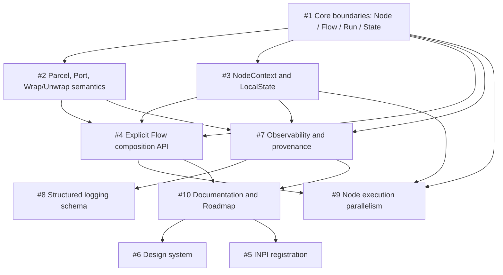

# Reed Roadmap

This roadmap organizes Reed's open architectural work by implementation impact.

Reed's current architectural baseline is described in [`architecture.md`](./architecture.md).

---

## Priority Model

Priorities are defined by architectural dependency and implementation impact.

### Blocking

A blocking item changes or constrains Reed's core execution model, public API, runtime boundaries, or data model.

If a blocking decision changes later, dependent projects and later Reed implementation work are likely to require rework.

### High

A high-priority item depends on the blocking architectural model and affects important runtime behavior, observability, correctness, or maintainability.

These items should be designed early, but they should not force premature decisions on the core API or execution semantics.

### Low

A low-priority item is useful, but does not currently block Reed's implementation model or projects depending on Reed.

These items can proceed after the core roadmap is stable, or in parallel when they do not interfere with architectural decisions.

---

## Dependency Graph



---

## Blocking Work

### #1 Explore explicit Node, Flow, Run, and runtime state boundaries

This is the first architectural blocker.

Reed needs stable semantic boundaries between:

- `Node`
- `Flow`
- `Run`
- `SharedState`
- `LocalState`
- artifacts
- messages and events

This issue should establish what each concept owns, how long it lives, and which parts belong to definition time versus execution time.

Expected outcome:

- define the semantic boundary between `Node`, `Flow`, and `Run`;
- define ownership and lifecycle of runtime state;
- clarify the distinction between state, artifacts, events, and messages;
- map Composition, Activation, Synchronization, and Transport onto the resulting model.

### #2 Explore automatic Parcel wrapping and unwrapping at Node boundaries

This is a blocking data model issue.

Reed needs to decide how domain values enter and leave the runtime while preserving execution identity, provenance, activation, synchronization, and transport semantics.

Important decisions include:

- what a `Parcel` is;
- whether `Parcel` is an artifact, envelope, runtime occurrence, or combination;
- where wrapping and unwrapping happen;
- how `InputPort` and `OutputPort` are represented;
- how multiple producers of the same Python type are disambiguated;
- how provenance survives automatic wrapping;
- what backward-compatible escape hatch exists for explicit Parcel access.

Expected outcome:

- define `Parcel[T]` conceptually;
- separate payload type from runtime identity;
- define Node ports independently of Parcel subclasses;
- preserve existing Parcel-based runtime behavior while simplifying user-facing Node signatures.

### #3 Explore Node execution context and local runtime state

This is a blocking execution semantics issue.

Reed needs to decide whether Node functions may receive a controlled runtime context, and what that context may expose.

Important decisions include:

- whether `NodeContext` exists;
- whether context injection affects function signatures;
- how `LocalState` differs from previous output Parcels;
- whether state transitions are atomic with output production;
- how retries, checkpointing, and concurrency interact with local state.

Expected outcome:

- define `NodeContext` as a controlled runtime capability boundary, if adopted;
- define `LocalState` ownership and lifetime;
- keep runtime-provided context distinct from dataflow inputs;
- avoid coupling user code directly to internal `NodeRuntime`.

### #4 Replace `@flow` with an explicit Flow composition API

This is a blocking public API issue.

The Flow API determines how downstream projects compose Reed Nodes, connect dependencies, register callbacks, and trigger execution.

The current direction is to investigate replacing:

```python
@flow
def pipeline(...):
    ...
```

with an explicit composition object:

```python
flow = Flow()
flow.add_node(source)
flow.add_node(process, callback=on_processed)
flow.add_node(store)
flow.connect(source, process)
flow.connect(process, store)
flow.run()
```

Expected outcome:

- introduce `Flow` as an explicit composition object;
- define `add_node()`, `connect()`, and execution entry points;
- decide whether `@flow` remains temporarily for compatibility;
- keep callbacks observational until runtime semantics are clearer;
- define how multiple registrations of the same Node are identified.

---

## High Priority Work

### #7 Design OpenTelemetry-based execution tracing and provenance

Observability depends on the core execution model.

Reed should use OpenTelemetry as infrastructure for tracing, correlation, recording, and export, while preserving Reed-specific semantics for execution and provenance.

This work depends on:

- `Run` identity;
- `NodeExecution` semantics;
- `Parcel` identity and provenance;
- `State` semantics;
- activation and synchronization causality.

Expected outcome:

- define a canonical execution record;
- map Reed concepts to OTel traces, spans, events, metrics, and links;
- preserve Parcel as a first-class Reed provenance entity;
- support local-first and offline recording;
- avoid coupling Reed's public model to OTel implementation details.

### #8 Define a structured logging schema

Structured logging should follow the observability model rather than invent a separate language for execution events.

This work depends on issue #7 because logs should share stable identifiers and semantic conventions with tracing and provenance.

Expected outcome:

- define stable base fields;
- document service-specific extension fields;
- provide shared logging helpers;
- keep names consistent across services, tools, and future dashboards.

### #9 Node execution parallelism

Parallelism should come after the core execution and state model.

Running Nodes concurrently affects:

- `Run` lifecycle;
- `NodeRuntime` isolation;
- `LocalState` mutation;
- `SharedState` consistency;
- activation order;
- failure behavior;
- tracing and provenance.

Expected outcome:

- define which Nodes may execute concurrently;
- define ordering guarantees;
- define state synchronization rules;
- define how concurrent execution appears in traces and provenance records.

### #10 Documentation and Roadmap

Documentation should remain aligned with architectural decisions instead of becoming a parallel source of truth.

This issue depends on the blocking work because the roadmap and architecture docs should describe stable concepts, not temporary implementation guesses.

Expected outcome:

- maintain `architecture.md` as the architectural baseline;
- maintain this roadmap as a dependency-oriented planning document;
- update documentation when blocking decisions are accepted or revised.

---

## Low Priority Work

### #6 Build design system

The design system is useful for future user-facing tools and documentation, but it does not currently block Reed's core runtime or API.

It should follow the concepts stabilized by the architecture and roadmap.

Expected outcome:

- define visual and interaction conventions for Reed-facing interfaces;
- support future trace, graph, and documentation views;
- avoid locking the project into UI assumptions before the runtime model is stable.

### #5 Register Reed software with INPI

INPI registration is important as a project and intellectual-property milestone, but it does not drive implementation order.

It should happen after Reed has a coherent architectural description and enough stable documentation to describe the software clearly.

Expected outcome:

- prepare required project description;
- align registration material with the current architecture documentation;
- avoid registering a description that conflicts with near-term API and runtime changes.

---

## Suggested Execution Order

1. Resolve issue #1 enough to define the core vocabulary: `Node`, `Flow`, `Run`, `State`, `Artifact`, `Event`, `Message`, `NodeRuntime`, and `NodeExecution`.
2. Resolve issue #2 enough to define `Parcel`, payload boundaries, ports, automatic wrapping, automatic unwrapping, and provenance identity.
3. Resolve issue #3 enough to decide whether `NodeContext` exists and how `LocalState` behaves inside a Run.
4. Resolve issue #4 enough to stabilize the public Flow composition API used by downstream projects.
5. Use issues #1, #2, #3, and #4 to update `architecture.md`.
6. Design issue #7 using the stabilized execution model, especially `Run`, `NodeExecution`, `Parcel`, `State`, and causality.
7. Define issue #8 as a thin structured logging layer aligned with issue #7.
8. Design issue #9 after state, context, and Flow composition semantics are explicit.
9. Keep issue #10 active as the documentation control point.
10. Proceed with issue #6 and issue #5 after the core implementation story is coherent.

---

## Issue Map

| Priority | Issue | Area | Main dependency |
|---|---:|---|---|
| Blocking | #1 | Core semantics | Architectural baseline |
| Blocking | #2 | Parcel and ports | #1 |
| Blocking | #3 | NodeContext and LocalState | #1, #2 |
| Blocking | #4 | Public Flow API | #1, #2, #3 |
| High | #7 | Observability and provenance | #1, #2, #3 |
| High | #8 | Structured logging | #7 |
| High | #9 | Parallel execution | #1, #3, #4 |
| High | #10 | Documentation and roadmap | #4, #7 |
| Low | #6 | Design system | #10 |
| Low | #5 | INPI registration | #10 |
