# Reed Architectural Roadmap

- Generated by ChatGPT. Still in review. It's more of an idea dump than a real roadmap.

## Purpose

Reed is evolving from a dataflow execution mechanism into a more explicit computational framework with its own execution semantics, data model, runtime behavior, provenance, and observability.

Several architectural changes are already being explored independently:

- separation between `Node`, `Flow`, and `Run`;
- simplification of the public Flow API;
- removal of the user-facing `Parcel` wrapper;
- introduction of `NodeContext`;
- clearer separation between SharedState and LocalState;
- OpenTelemetry-based execution tracing;
- Parcel and State provenance;
- persistent execution records;
- future integration with Loom.

These changes are strongly related.

The purpose of this roadmap is therefore not to establish release dates, but to define the **architectural dependency order** in which Reed should evolve.

The general direction is:

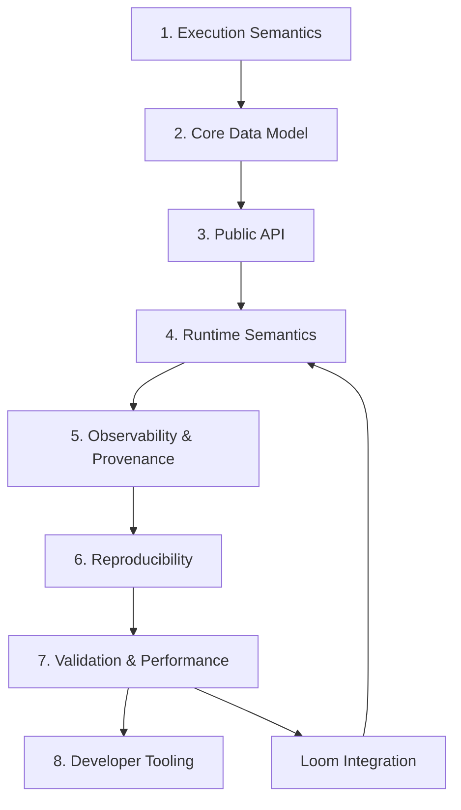

Loom should act as a **validation driver** for Reed, not define Reed's abstractions.

---

# 1. Execution Semantics

## Objective

Formally define what a Reed execution means.

Before optimizing the API or recording executions, Reed needs an explicit computational model.

The fundamental relationship should become unambiguous:

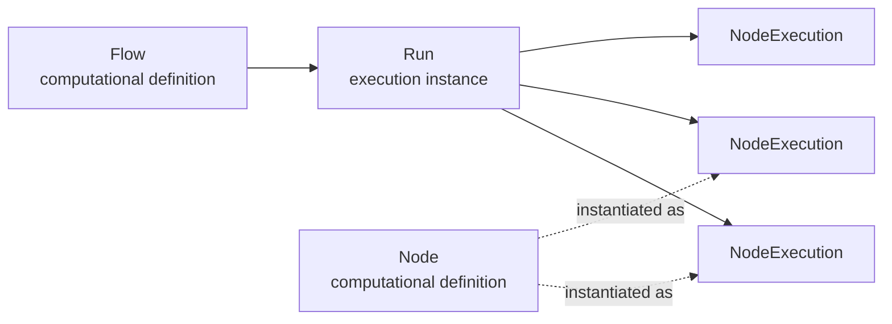

Questions to define include:

- What creates a `Run`?
- What starts a Run?
- When is a Node eligible for execution?
- What exactly creates a `NodeExecution`?
- What is a Trigger?
- Can the same Node execute concurrently?
- What ordering guarantees exist?
- What happens when multiple inputs arrive independently?
- What constitutes completion of a Run?
- What constitutes failure of a Run?
- What happens to Parcels that are never consumed?
- Are executions synchronous, asynchronous, or agnostic to this distinction?
- Which guarantees belong to Reed and which belong to Transport or Synchronization?

## Expected result

A short normative document:

```text
docs/design/execution-model.md
```

This document should describe Reed's semantics independently from the current Python implementation.

## Impact

**Very high.**

Almost every subsequent architectural decision depends on this model.

---

# 2. Core Data Model

## Objective

Formalize the entities that participate in computation.

The main model currently appears to be:

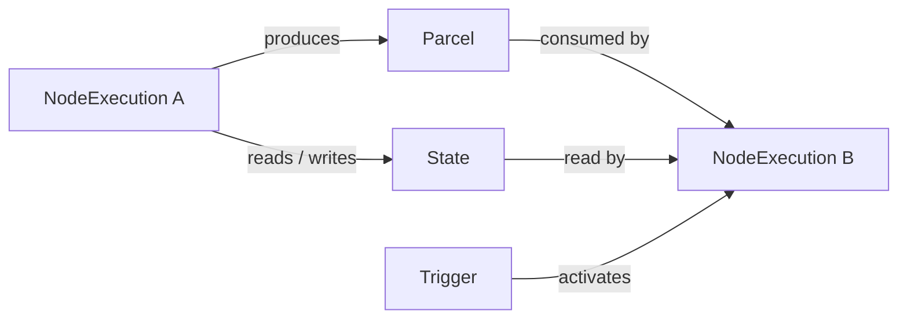

The important distinction is:

```text
Definitions:
    Flow
    Node

Executions:
    Run
    NodeExecution

Data:
    Parcel
    State

Causality:
    Trigger
```

## Parcel

Define precisely:

- identity;
- lifetime;
- ownership;
- type;
- schema;
- serialization;
- immutability/mutability;
- producer;
- consumers;
- behavior under fan-out;
- behavior under retry.

A useful conceptual definition is:

> A Parcel is a typed data artifact produced by one NodeExecution and potentially consumed by subsequent NodeExecutions.

The user-facing API does not necessarily need to expose a `Parcel` wrapper even if Parcel remains a fundamental internal Reed concept.

## State

Clarify:

```text
State
├── SharedState
└── LocalState
```

Define:

- ownership;
- visibility;
- mutation semantics;
- lifetime;
- consistency;
- versioning;
- concurrency behavior.

## NodeContext

NodeContext should provide runtime context without requiring runtime infrastructure to leak into the Node API.

Potential responsibilities:

```text
NodeContext
├── execution identity
├── local state
├── access to relevant Parcel metadata
└── controlled runtime services
```

Its responsibilities should remain deliberately narrow.

## Impact

**Very high.**

This establishes Reed's computational vocabulary.

---

# 3. Public API

## Objective

Make simple computations simple to express while preserving access to lower-level primitives.

The current direction is toward an imperative Flow API:

```python
flow = Flow()

flow.add_node(...)
flow.add_node(...)
```

rather than requiring `@flow`.

The public API should hide runtime machinery that users do not need to manipulate directly.

A useful design principle is:

> **Simple things should have a small API; advanced behavior should remain accessible without changing the underlying model.**

The architecture should distinguish:

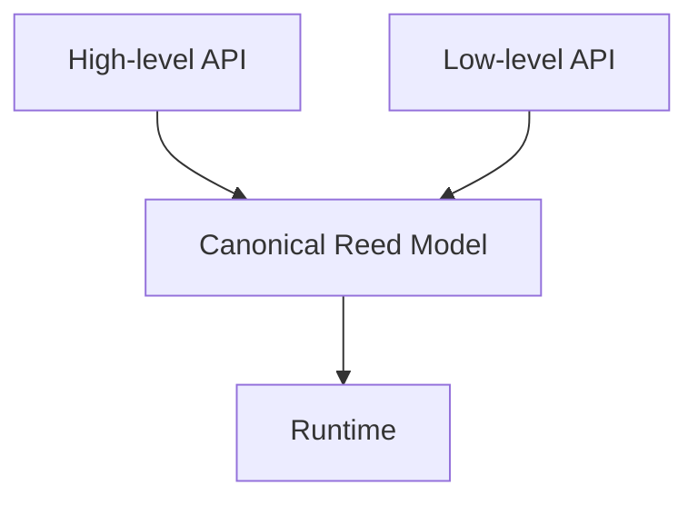

Both APIs should construct or manipulate the **same underlying computational representation**.

## Areas to explore

- imperative Flow construction;
- Node registration;
- callback signatures;
- NodeContext;
- automatic input/output handling;
- type annotations;
- validation;
- introspection;
- error messages;
- compatibility between convenience APIs and low-level primitives.

## Impact

**High.**

API design strongly affects adoption, but it should follow the semantic model rather than define it.

---

# 4. Runtime Semantics

This phase contains several topics that should be designed together.

## 4.1 Lifecycle

Define explicit lifecycle states.

For example:

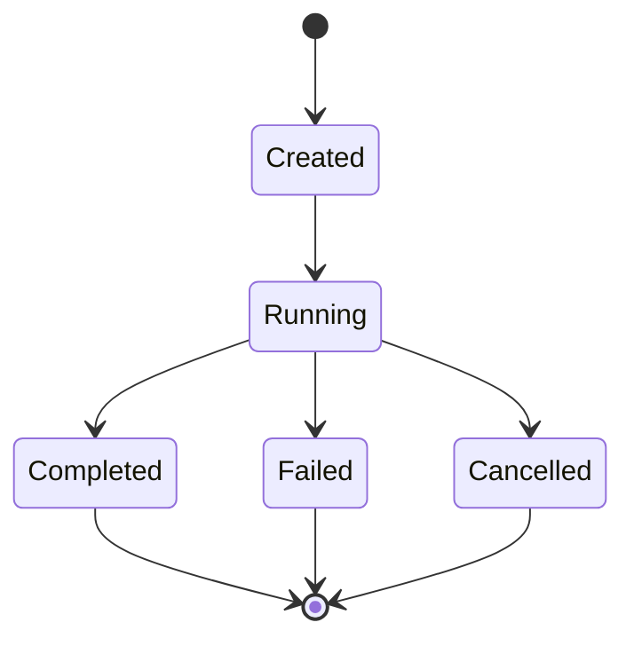

Potential NodeExecution lifecycle:

```text
PENDING
RUNNING
COMPLETED
FAILED
CANCELLED
```

Derive the exact states from actual Reed semantics rather than copying them from generic workflow engines.

---

## 4.2 Failure semantics

Define what happens when a NodeExecution fails.

Example:

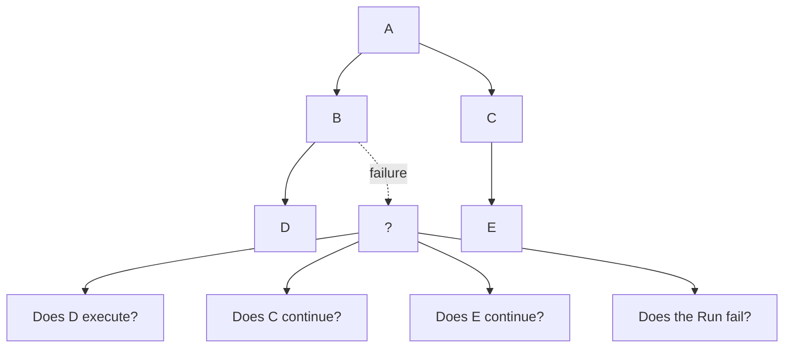

Questions include:

- fail-fast vs. partial continuation;
- propagation;
- retries;
- cleanup;
- partially produced Parcels;
- State mutations before failure;
- retry identity;
- provenance across retries.

---

## 4.3 Cancellation

Design cancellation before it becomes necessary.

Questions include:

- Can an entire Run be canceled?
- Can a NodeExecution be canceled?
- Is cancellation cooperative?
- What happens to synchronization waits?
- What happens to queued Parcels?
- What cleanup guarantees exist?
- Is cancellation itself part of provenance?

Potential API:

```python
run.cancel()
```

The exact API is secondary to defining the semantics.

---

## 4.4 Time model

Reed should avoid assuming that wall-clock time is the only meaningful notion of time.

This is particularly important for simulation frameworks such as Loom.

Potential distinction:

```text
Wall Time
    actual physical clock

Execution Time
    runtime duration

Domain / Simulation Time
    time represented by the computational model
```

For example:

```text
wall_time       = 05:21:31.842
execution_time  = 1.37 ms
simulation_time = 138.2 s
```

Reed does not need to become a discrete-event simulator.

It should simply avoid making future alternative clocks impossible.

## Impact

**Very high**, particularly for Loom and future asynchronous execution.

---

# 5. Observability & Provenance

## Objective

Provide a canonical structured representation of every Reed Run.

The current hypothesis is:

> Reed should use OpenTelemetry as its tracing infrastructure while maintaining a Reed-specific semantic and provenance model.

Architecture:

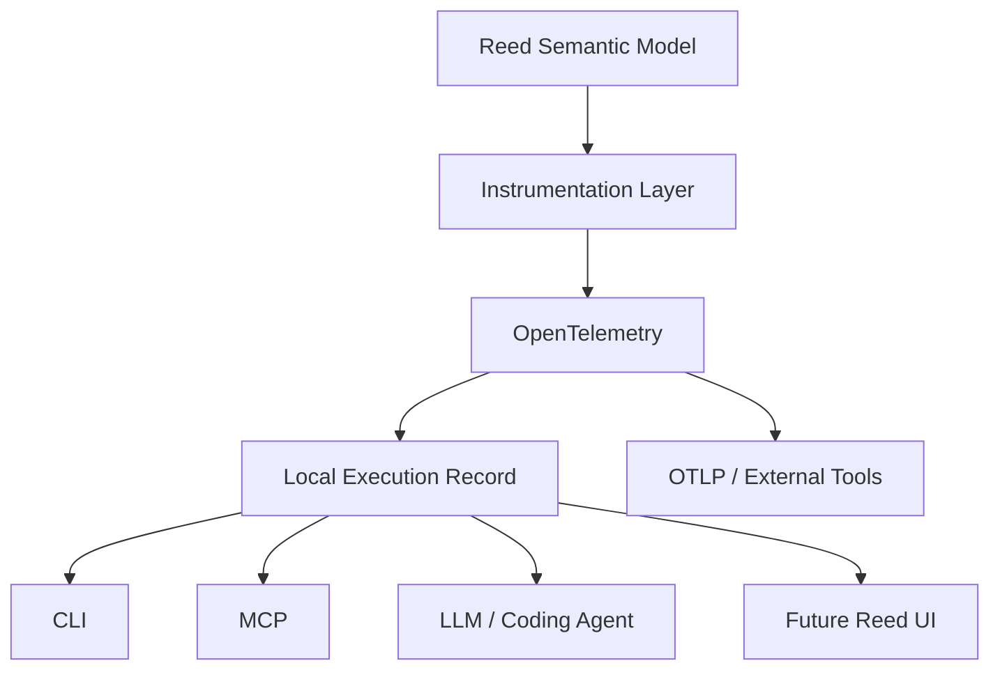

Initial mapping:

| Reed | Representation |
|---|---|
| Flow | metadata |
| Run | Trace + root Span |
| Node | metadata |
| NodeExecution | Span |
| Parcel | provenance entity |
| Parcel production/consumption | correlated structured event |
| Trigger | event / attributes / causal link |
| State | provenance entity |
| State change | structured event |
| Runtime measurements | Metrics |
| complex causal relationships | Span Links |

The detailed design belongs in:

```text
docs/design/observability.md
```

## Impact

**Very high**, but dependent on stable execution semantics.

---

# 6. Reproducibility

## Objective

Make a Reed Run identifiable and, where possible, reproducible.

A Run can conceptually be described by:

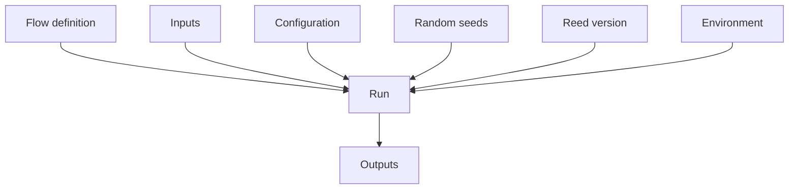

Potential metadata:

```text
reed version
flow version
flow graph hash
input artifact hashes
configuration
random seeds
environment information
dependency versions
```

## Initial goal

The immediate goal does **not** need to be deterministic replay.

The initial requirement is:

> Preserve enough execution identity that replay and reproducibility remain possible future capabilities.

## Areas to explore

- deterministic execution;
- random seed management;
- environment capture;
- dependency identity;
- Flow hashing;
- artifact hashing;
- state snapshots;
- partial replay;
- complete replay.

## Impact

**High**, especially for scientific use.

---

# 7. Validation & Performance

Architecture should be validated with real workloads rather than only unit tests.

## Loom as validation driver

Loom provides a valuable first demanding consumer.

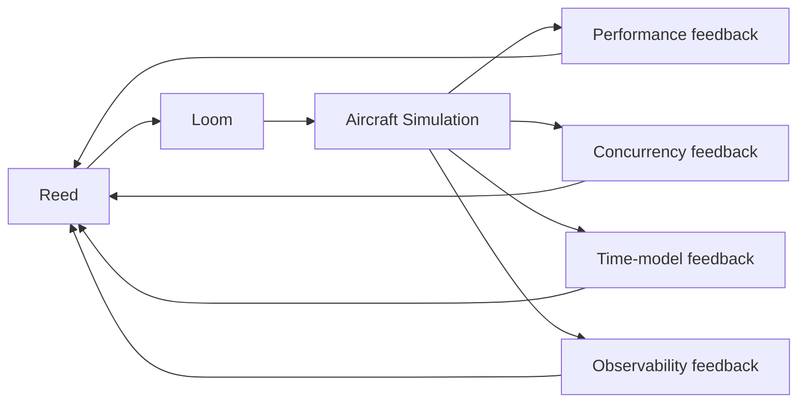

Loom should expose weaknesses in Reed without forcing Reed to become airspace-specific.

## Validation areas

### Correctness

- activation;
- synchronization;
- Parcel propagation;
- State consistency;
- failure propagation.

### Concurrency

- simultaneous activations;
- fan-in;
- fan-out;
- concurrent State access;
- ordering.

### Performance

Measure:

```text
NodeExecution overhead
Parcel transport overhead
synchronization latency
tracing overhead
serialization overhead
memory usage
execution-record size
```

### Stress tests

Explore:

- thousands of Nodes;
- high-frequency triggers;
- large Parcels;
- long Runs;
- many concurrent NodeExecutions.

## Impact

**High.**

Optimization should follow measurement.

---

# 8. Developer Tooling

Only after the underlying model becomes stable should Reed invest heavily in tooling.

Potential tools include:

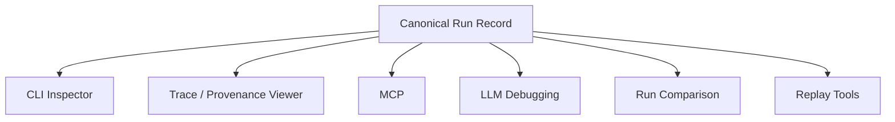

Possible future commands:

```text
reed runs
reed inspect <run>
reed trace <run>
reed provenance <parcel>
reed failures <run>
reed compare <run-a> <run-b>
```

The canonical structured record should make these consumers relatively inexpensive to build.

---

# Cross-cutting exploration areas

Some topics should remain active throughout the roadmap rather than belonging to one phase.

## Type system

Explore how Python typing can describe:

- Node inputs;
- Node outputs;
- Parcel schemas;
- State;
- compatibility between connected Nodes.

Avoid building a custom type system unless Python's existing mechanisms prove insufficient.

---

## Serialization

Define a serializer boundary rather than assuming everything is JSON.

Potentially:

```text
Python Object
      │
      ▼
Serializer
      │
      ├── JSON
      ├── binary
      ├── external artifact
      └── metadata-only
```

Serialization affects Transport, provenance, persistence, distributed execution, and replay.

---

## Introspection

Reed should increasingly be able to describe itself.

Potential interface:

```python
flow.nodes
flow.edges
flow.describe()

run.status
run.executions
```

This supports:

- debugging;
- documentation;
- visualization;
- observability;
- testing;
- LLM tooling.

---

## Schema evolution

Persisted structures need explicit versions:

```text
Flow schema
Execution record schema
Parcel schema
Telemetry semantic conventions
```

Historical Runs should remain interpretable.

---

## Concurrency

Treat concurrency semantics as part of the computational model rather than merely an implementation optimization.

Questions include:

- Node reentrancy;
- ordering;
- State synchronization;
- parallel consumers;
- backpressure.

---

## Backpressure

Because Reed applies to dynamic systems, producers may eventually generate work faster than consumers can process it.

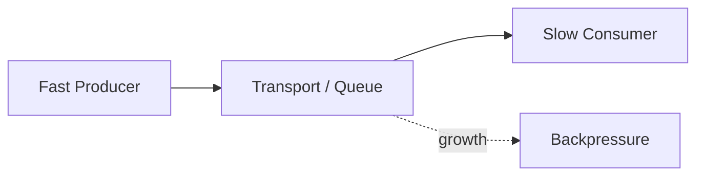

Explore this before introducing arbitrary queue behavior.

---

# Priority summary

The architectural priorities are:

```text
P0  Execution Semantics
P0  Core Data Model

P1  Public API
P1  Lifecycle / Failure / Cancellation
P1  Time Model

P1  Observability / Provenance

P2  Reproducibility
P2  Introspection

P2  Validation / Performance
P2  Loom Integration

P3  CLI / Visualization / MCP / LLM tooling
P3  Replay
P3  Distributed execution
```

Ordering matters more than the priority labels.

---

# Architectural direction

The desired long-term structure is:

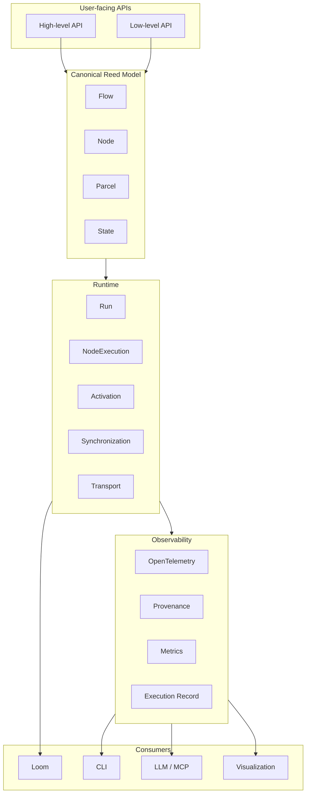

The most important architectural boundary is:

> **The Reed semantic model should remain independent from its execution engine, telemetry implementation, and consumers.**

This lets you evolve each layer without redefining what a Flow, Node, Run, Parcel, or State means.

---

# Immediate next steps

The next work should concentrate on the foundation rather than adding features.

1. Formalize the Reed execution model.
2. Formalize Parcel, State, Trigger, and NodeExecution semantics.
3. Complete the ongoing API redesign.
4. Define lifecycle, failure, and cancellation behavior.
5. Decide how Reed represents time.
6. Implement the minimal OpenTelemetry proof of concept.
7. Use Loom to stress-test the resulting architecture.
8. Measure before introducing performance optimizations.
9. Only then expand developer tooling.

The short-term objective, therefore, is not to make Reed larger.

It is to make its **core semantics small, explicit, stable, inspectable, and composable**.
