Created: 2026-09-09

## Notes
- Generated by ChatGPT. Still in review. It's more of an idea dump than a real roadmap.
- Take care of filtering the information this document contains. It does not reflect the real development and should be treated carefully.


# Reed Architectural Roadmap

## Purpose

Reed is undergoing a set of related architectural improvements involving its execution model, data model, public API, runtime behavior, and observability.

Several of these changes affect the same fundamental concepts and therefore should not evolve independently.

This roadmap organizes these efforts by **architectural dependency**, rather than by release date.

It is intentionally focused on Reed itself. Applications, frameworks, and systems built on top of Reed are outside its scope.

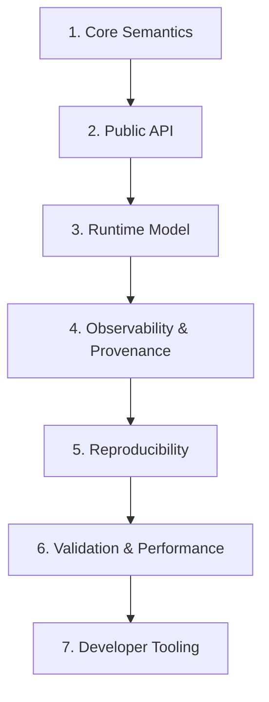

The ordering is directional rather than strictly sequential. Some work may happen concurrently, but later areas should not impose semantics on earlier layers.

---

# 1. Core Semantics

## Objective

Make Reed's fundamental computational concepts explicit and internally consistent.

Before adding more runtime capabilities, Reed should have clear answers for what its main abstractions mean and how they relate.

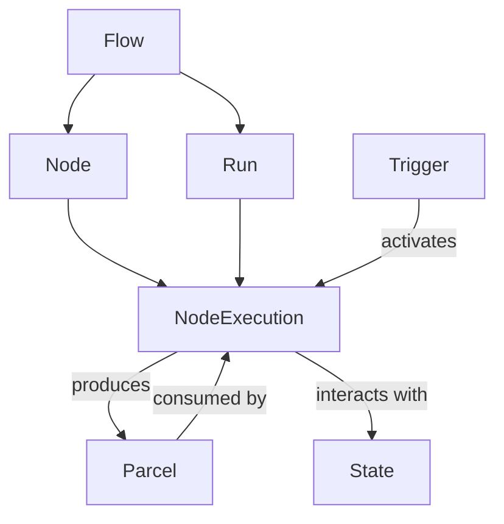

This diagram is conceptual and should not be interpreted as a final implementation model.

## Execution semantics

Clarify questions such as:

- What is a `Flow`?
- What is a `Run`?
- What is a `NodeExecution`?
- What creates a Run?
- What starts and terminates a Run?
- When is a Node eligible to execute?
- What causes a NodeExecution?
- Can the same Node execute concurrently?
- What ordering guarantees exist?
- What happens when multiple inputs arrive independently?
- What constitutes successful completion?
- What constitutes failure?

The goal is not necessarily to expose all of these concepts through the public API.

The goal is to make their semantics explicit.

## Parcel semantics

Clarify:

- identity;
- lifetime;
- type;
- ownership;
- production;
- consumption;
- fan-out;
- fan-in;
- mutability;
- behavior during failures and retries.

A particularly important distinction is between the **internal role of Parcel in Reed's execution model** and how much of that abstraction should appear in the user-facing API.

## State semantics

Clarify:

- SharedState;
- LocalState;
- ownership;
- visibility;
- mutation;
- lifetime;
- consistency;
- concurrency;
- relationship with NodeExecution.

## Trigger semantics

Clarify what a Trigger represents and how it relates to:

- activation;
- causality;
- synchronization;
- Parcel arrival;
- runtime events.

## Areas of exploration

- formal execution model;
- causal execution;
- data-flow semantics;
- state semantics;
- concurrency semantics;
- ordering guarantees;
- execution identity.

## Expected outcome

A small set of stable concepts that can serve as the foundation for the runtime, API, tracing, and future evolution of Reed.

---

# 2. Public API

## Objective

Simplify the user-facing API while preserving the expressiveness of Reed's computational model.

Current areas under investigation include:

- removing unnecessary decorators;
- imperative Flow construction;
- simpler Node registration;
- callback-based Node definitions;
- automatic handling of inputs and outputs;
- `NodeContext`;
- reducing exposure of runtime infrastructure;
- simplifying Parcel interaction.

Conceptually:

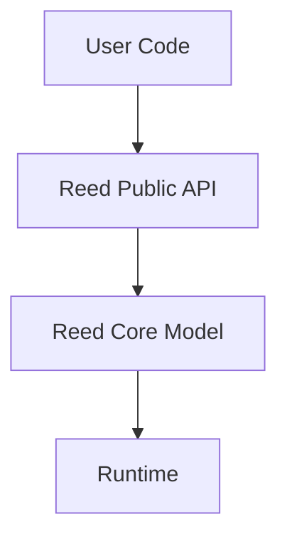

The public API should be designed around usability, while the runtime should depend on stable internal semantics rather than surface syntax.

## NodeContext

Explore whether runtime information required by a Node should be provided through a controlled execution context.

Potential responsibilities may include:

- access to local execution context;
- controlled State access;
- relevant Parcel information;
- execution metadata.

Its responsibilities should remain narrow enough that Nodes do not become tightly coupled to the runtime implementation.

## API principles to investigate

- minimal surface area;
- explicit behavior;
- predictable composition;
- useful defaults;
- type safety where practical;
- clear errors;
- low coupling between user code and runtime internals.

## Areas of exploration

- callback signatures;
- Node registration;
- graph construction;
- context injection;
- input/output declaration;
- validation;
- typing;
- backwards compatibility.

---

# 3. Runtime Model

## Objective

Define the behavior of executions beyond the basic Node/Parcel relationship.

This includes lifecycle, failure, cancellation, synchronization, concurrency, and time.

---

## 3.1 Lifecycle

Investigate explicit lifecycle semantics for Runs and NodeExecutions.

A possible Run lifecycle might resemble:

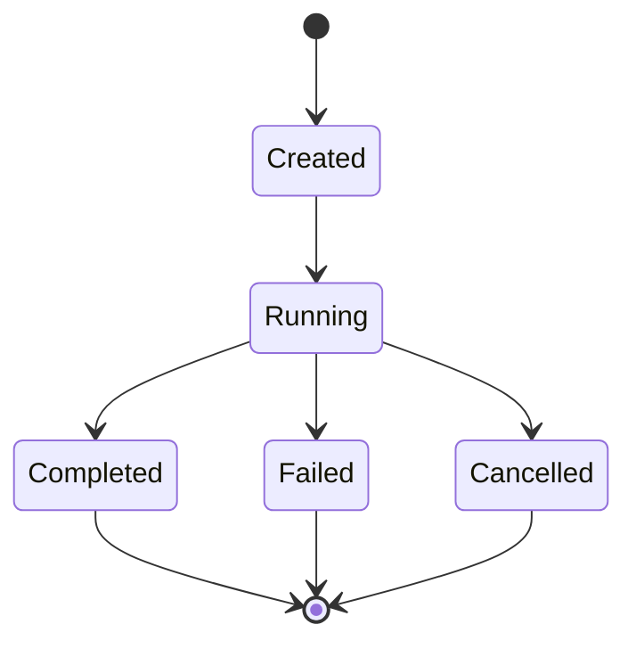

This is an exploration model rather than a proposed final state machine.

Questions include:

- Which lifecycle states are actually necessary?
- Which transitions are legal?
- Who owns those transitions?
- Which transitions are observable?
- How do nested/runtime operations relate to Run lifecycle?

---

## 3.2 Failure semantics

Define how failures propagate through an execution.

Example:

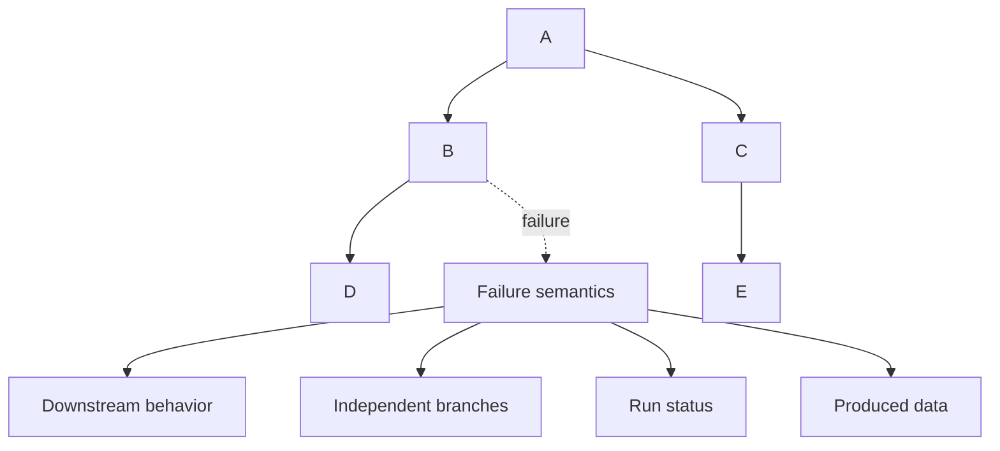

Questions include:

- Does one NodeExecution failure fail the Run?
- Can independent execution continue?
- What happens to downstream Nodes?
- What happens to Parcels already produced?
- What happens to State changes?
- Are retries supported?
- How are retry attempts identified?
- What cleanup guarantees exist?

Failure semantics should be explicit rather than emerging accidentally from implementation behavior.

---

## 3.3 Cancellation

Investigate cancellation as a first-class runtime concern.

Questions include:

- Can a Run be cancelled?
- Can an individual operation be cancelled?
- Is cancellation cooperative?
- What happens to pending work?
- What happens to blocked synchronization?
- What happens to queued data?
- What cleanup guarantees exist?
- How is cancellation distinguished from failure?

Cancellation is substantially easier to support when considered during runtime design rather than added afterward.

---

## 3.4 Time

Investigate the assumptions Reed makes about time.

Relevant concepts may include:

```text
wall-clock time
execution duration
logical/event time
externally supplied time
```

The initial objective is not to introduce multiple clock models.

The objective is to identify where Reed currently assumes wall-clock semantics and determine whether those assumptions should belong to the core runtime.

Questions include:

- Which runtime operations actually require a clock?
- Is time part of execution semantics or instrumentation?
- Should runtime components depend on a clock abstraction?
- Which timestamps belong to Reed and which belong to observability?

---

## 3.5 Synchronization

Clarify the responsibilities of the Synchronization layer.

Questions include:

- What conditions make execution eligible?
- How are multiple required inputs handled?
- What is the lifetime of synchronization state?
- How are duplicate or late inputs handled?
- How does synchronization interact with failure and cancellation?

---

## 3.6 Activation

Clarify the boundary between synchronization and activation.

Conceptually:

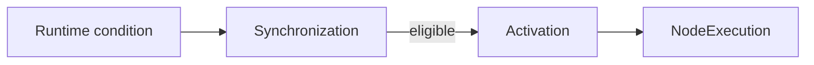

Questions include:

- What exactly constitutes activation?
- Is activation synchronous or asynchronous?
- Can activation be rejected or delayed?
- How is activation identity represented?

---

## 3.7 Transport

Clarify the responsibility of Transport independently from Node semantics.

Potential concerns include:

- delivery;
- buffering;
- ordering;
- serialization boundaries;
- local vs. remote transport;
- backpressure;
- error handling.

The core abstraction should avoid assuming a particular transport mechanism.

---

# 4. Observability & Provenance

## Objective

Provide a structured representation of Reed executions suitable for debugging, analysis, persistence, and external tooling.

The current architectural hypothesis is:

> **Use OpenTelemetry as tracing infrastructure while maintaining Reed-specific execution and provenance semantics.**

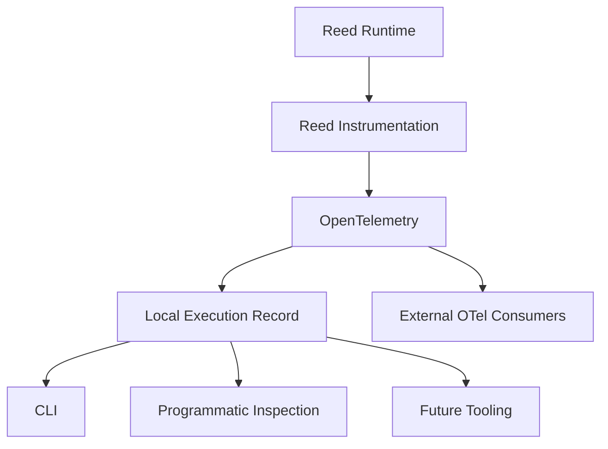

## Initial semantic mapping

| Reed | Candidate representation |
|---|---|
| `Flow` | metadata |
| `Run` | Trace / root Span |
| `Node` | metadata |
| `NodeExecution` | Span |
| `Parcel` | Reed provenance entity |
| Parcel production | structured correlated event |
| Parcel consumption | structured correlated event |
| `Trigger` | attributes / event / causal relationship |
| `State` | Reed provenance entity |
| State change | structured correlated event |
| Exceptions | error/exception telemetry |
| Runtime measurements | Metrics |
| Non-hierarchical causality | Span Links / provenance relationships |

## Execution trace

Represent operational execution:

```text
Run
├── NodeExecution A
├── NodeExecution B
└── NodeExecution C
```

## Provenance

Represent data causality:

```text
Node A
   │
 Parcel
   │
   ├── Node B
   └── Node C
```

An important investigation is whether both can be reconstructed from the same canonical execution record.

## Local-first recording

Execution records should remain useful without requiring an external observability service.

Areas to investigate:

- local persistence;
- record structure;
- storage format;
- structured events;
- artifact references;
- payload previews;
- hashes;
- schema versioning;
- configurable recording levels.

## Areas of exploration

- OpenTelemetry integration;
- tracing;
- metrics;
- provenance;
- structured runtime events;
- local persistence;
- recording policies;
- payload handling;
- instrumentation overhead.

Detailed decisions should remain in a dedicated observability design document rather than in this roadmap.

---

# 5. Reproducibility

## Objective

Investigate what information is required to identify and understand a past execution reliably.

Conceptually:

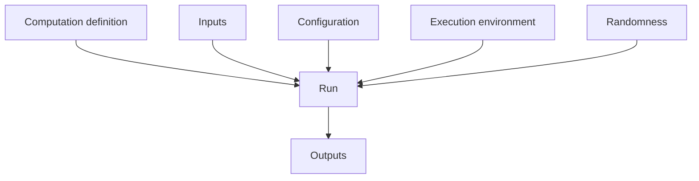

Potential information includes:

- Reed version;
- computation identity;
- configuration;
- input identities;
- artifact hashes;
- random seeds;
- dependency versions;
- environment metadata.

The immediate objective is **not deterministic replay**.

The question is:

> What information should Reed preserve today so that executions can be understood, compared, or potentially reproduced later?

## Areas of exploration

- execution identity;
- input identity;
- configuration capture;
- randomness;
- environment capture;
- artifact hashing;
- reproducibility guarantees;
- replay feasibility.

Replay should remain an exploration topic until the execution semantics and provenance model are sufficiently mature.

---

# 6. Validation & Performance

## Objective

Validate Reed's semantics and implementation under increasingly demanding generic workloads.

Validation should test the framework itself rather than optimize for any specific downstream application.

## Correctness

Test:

- Node activation;
- synchronization;
- Parcel propagation;
- State behavior;
- lifecycle transitions;
- failure propagation;
- cancellation;
- provenance reconstruction.

## Concurrency

Test:

```text
fan-in
fan-out
simultaneous activations
concurrent NodeExecutions
concurrent State access
ordering
```

## Performance

Measure rather than assume.

Candidate measurements:

```text
NodeExecution overhead
Parcel propagation overhead
synchronization latency
activation latency
serialization cost
tracing overhead
memory consumption
execution-record size
```

## Stress testing

Explore scenarios such as:

- many Nodes;
- many edges;
- high-frequency activation;
- long-running Runs;
- large Parcels;
- deep execution chains;
- wide fan-out;
- large fan-in;
- concurrent executions.

## Benchmarking

Establish reproducible benchmarks so architectural changes can be evaluated quantitatively.

The benchmark suite should distinguish:

```text
runtime overhead
instrumentation overhead
serialization overhead
transport overhead
```

## Areas of exploration

- benchmarking methodology;
- profiling;
- scalability;
- memory behavior;
- concurrency;
- instrumentation cost;
- performance regression testing.

---

# 7. Developer Tooling

## Objective

Build tooling on top of stable runtime and observability foundations.

Potential tooling includes:

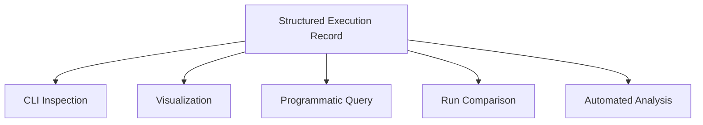

Potential commands might eventually include:

```text
reed runs
reed inspect <run>
reed trace <run>
reed provenance <parcel>
reed failures <run>
reed compare <run-a> <run-b>
```

These are illustrative rather than committed APIs.

The important architectural principle is that tooling should **consume structured Reed information rather than require additional instrumentation paths**.

## Areas of exploration

- CLI;
- execution inspection;
- provenance visualization;
- graph visualization;
- run comparison;
- automated debugging;
- machine-oriented interfaces;
- integration with external observability tools.

---

# Cross-cutting Exploration Areas

Some questions affect several roadmap areas and should remain explicitly open.

---

## Type System

Investigate how Reed can make effective use of Python's existing typing mechanisms for:

- Node inputs;
- Node outputs;
- Parcel types;
- State;
- connection compatibility;
- runtime validation.

A custom Reed type system should only be considered if existing Python mechanisms prove insufficient.

---

## Serialization

Serialization affects:

- Transport;
- persistence;
- provenance;
- artifact inspection;
- reproducibility.

The architecture should avoid assuming that every object is JSON-serializable.

Conceptually:

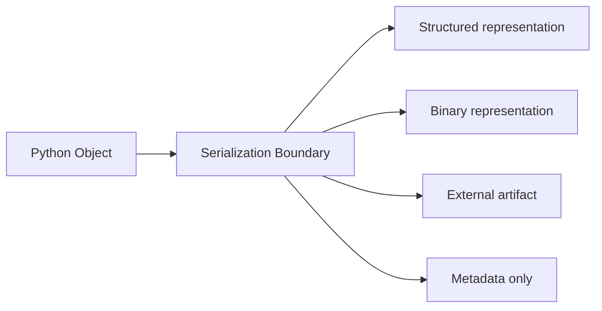

Questions include:

- Who owns serialization?
- When is serialization required?
- How are custom serializers registered?
- What happens when serialization fails?
- Is serialization part of Transport or a separate concern?

---

## Introspection

Investigate how Reed exposes its own structure and runtime state programmatically.

Potential questions:

- What Nodes exist?
- How are they connected?
- What inputs and outputs exist?
- What is currently executing?
- What is waiting?
- What data was produced?
- What failed?

Possible future interfaces:

```python
flow.nodes
flow.edges
flow.describe()

run.status
run.executions
```

These are illustrative only.

Introspection can support debugging, testing, documentation, observability, and tooling.

---

## Concurrency

Concurrency should be treated as a semantic concern rather than only a performance optimization.

Questions include:

- Node reentrancy;
- concurrent NodeExecutions;
- ordering guarantees;
- State access;
- synchronization;
- fairness;
- starvation;
- cancellation.

---

## Backpressure

Investigate behavior when work is produced faster than it can be consumed.

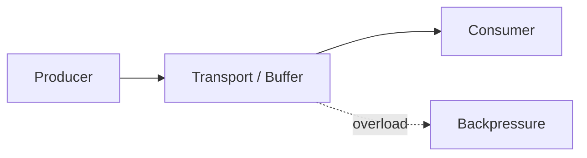

Questions include:

- Are buffers bounded?
- Who controls capacity?
- Can producers be suspended?
- Can data be rejected?
- Is dropping allowed?
- How is overload exposed?

No backpressure policy should be assumed before the Transport and execution semantics are clear.

---

## Schema Evolution

Persistent structures may eventually require explicit versioning.

Potentially:

```text
execution-record schema
telemetry conventions
serialized artifacts
persisted configuration
```

Questions include:

- How are historical records interpreted?
- Which formats require migration?
- Which structures are public contracts?
- Which structures are internal implementation details?

---

## Resource Management

Investigate ownership and cleanup of runtime resources.

Examples:

- threads;
- tasks;
- queues;
- transports;
- file handles;
- telemetry exporters;
- external resources.

Questions include:

- Who owns resources?
- When are they initialized?
- When are they released?
- What happens during failure?
- What happens during cancellation?

---

# Areas Deliberately Left Open

The roadmap should not prematurely decide questions that still require investigation.

In particular, it does not currently assume:

- a particular persistent Flow representation;
- that Flow must be serializable;
- a particular graph schema;
- a particular storage engine;
- a particular concurrency model;
- a particular scheduling strategy;
- distributed execution;
- deterministic replay;
- a specific visualization system;
- a specific serialization format;
- a specific clock model;
- a particular external consumer.

These decisions should emerge from the corresponding design investigations.

---

# Priority Map

The current architectural priorities are approximately:

```text
P0
├── Core execution semantics
├── Parcel semantics
├── State semantics
└── Trigger / activation semantics

P1
├── Public API redesign
├── NodeContext
├── Lifecycle
├── Failure semantics
├── Cancellation
├── Synchronization
├── Transport semantics
└── Observability / provenance

P2
├── Time model
├── Introspection
├── Reproducibility
├── Serialization
├── Concurrency
└── Benchmarking

P3
├── Backpressure
├── Advanced developer tooling
├── Run comparison
├── Automated analysis
└── Replay investigation
```

These priorities express **architectural dependency and expected impact**, not release commitments.

---

# Roadmap Overview

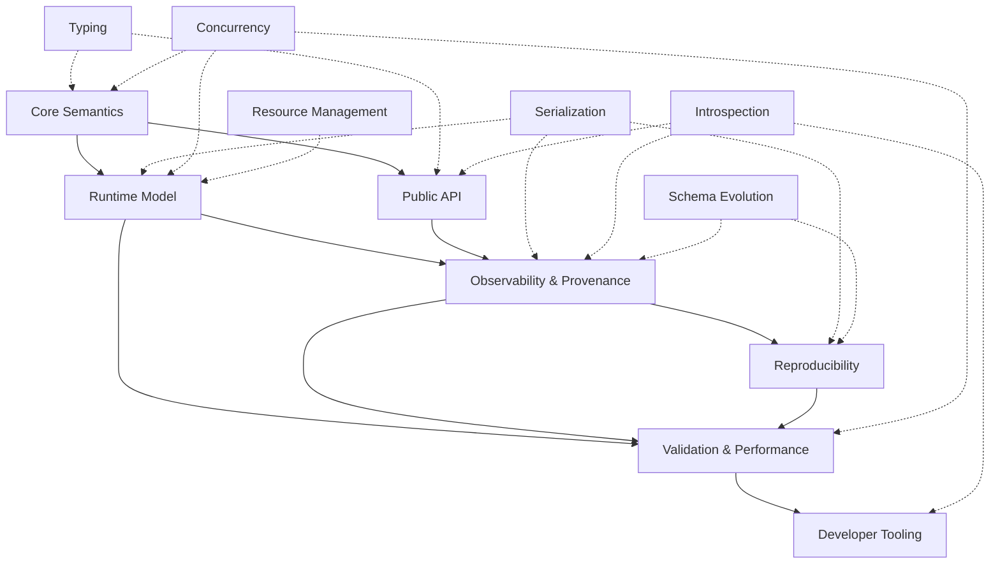

---

# Guiding Principles

## Semantics before implementation

Runtime behavior should follow explicit Reed concepts rather than allowing implementation details to define the semantics accidentally.

## Keep the core small

New abstractions should only enter Reed when they solve a problem that belongs to Reed itself.

## Separate concerns

Execution, data, state, transport, synchronization, observability, and presentation should have explicit boundaries.

## Prefer existing standards where appropriate

Infrastructure problems already solved by mature standards should not be unnecessarily reimplemented.

OpenTelemetry is one example currently under investigation.

## Do not optimize before measuring

Performance work should be driven by benchmarks and profiling.

## Structured information over textual output

When information may later need to be inspected programmatically, preserve structure and generate human-readable representations from it.

## Avoid premature commitments

Exploration topics should remain exploration topics until experiments provide enough evidence to establish a stable design.

---

# Immediate Direction

The highest-impact work is currently concentrated around four questions:

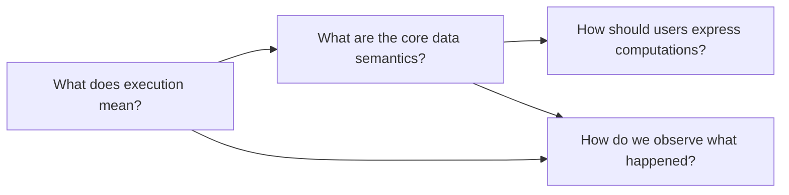

Therefore, the immediate direction is:

1. consolidate execution semantics;
2. consolidate Parcel, State, Trigger, and NodeExecution semantics;
3. continue simplifying the public API;
4. define lifecycle, failure, cancellation, synchronization, and Transport behavior;
5. validate the OpenTelemetry tracing/provenance hypothesis;
6. establish introspection and benchmarking foundations;
7. expand into reproducibility and tooling only as the underlying model stabilizes.

The goal of this roadmap is not to make Reed accumulate features.

The goal is to make Reed's foundations **small, explicit, coherent, observable, and robust enough that future capabilities can be added without repeatedly redesigning the core**.
